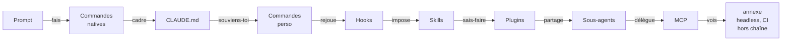
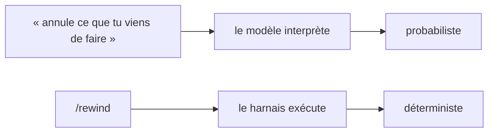
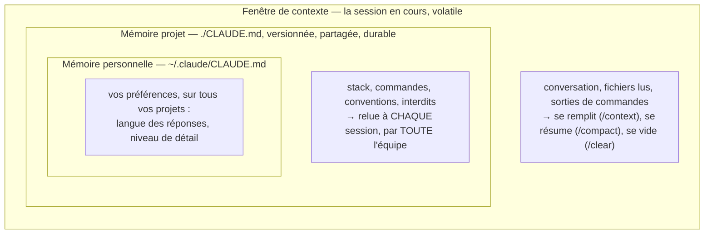
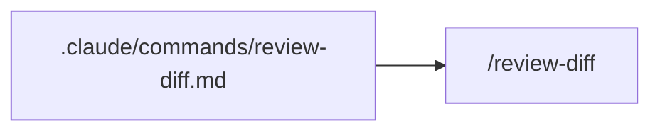
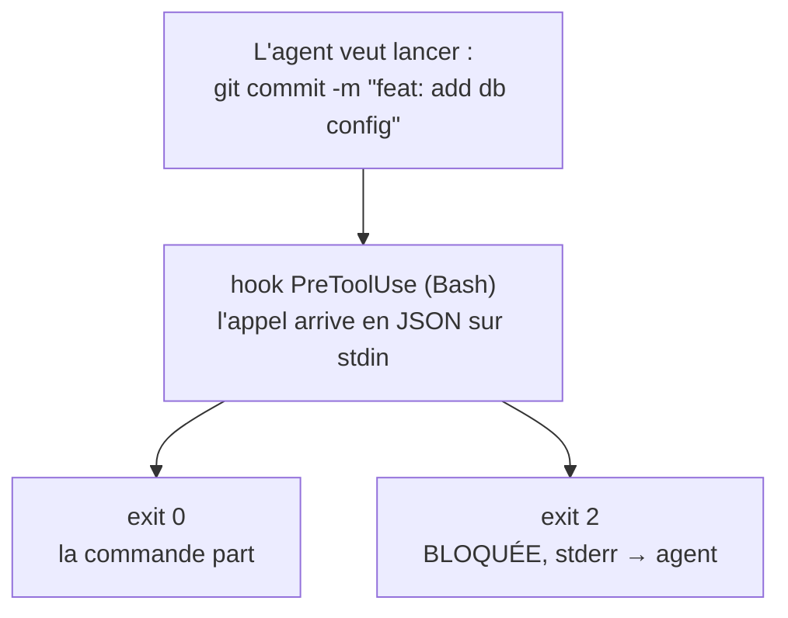
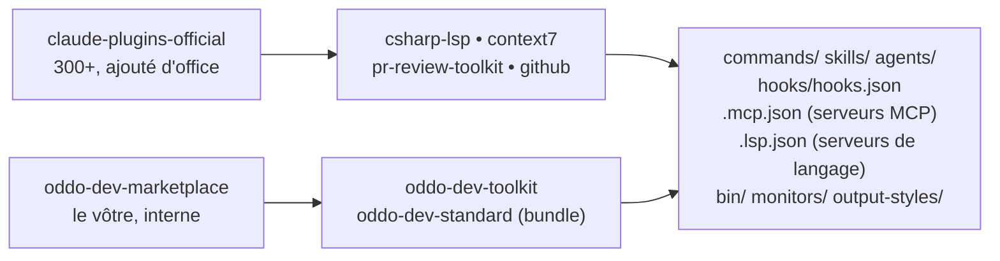
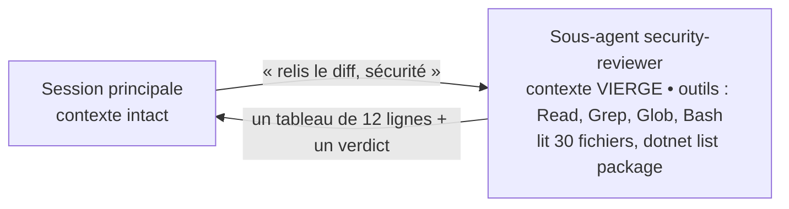
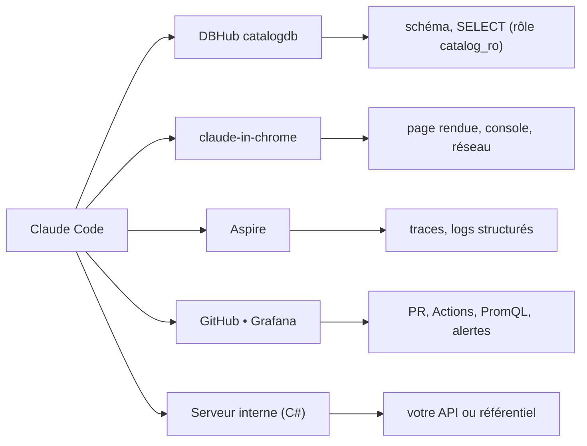
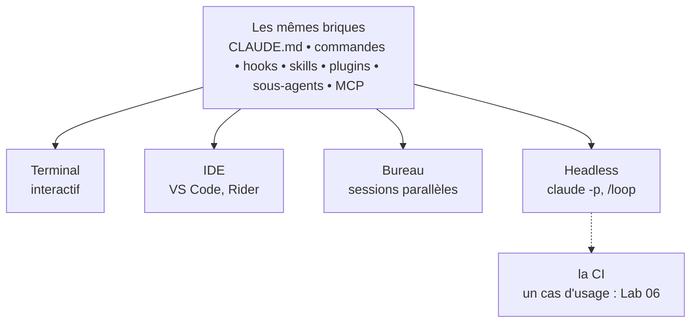
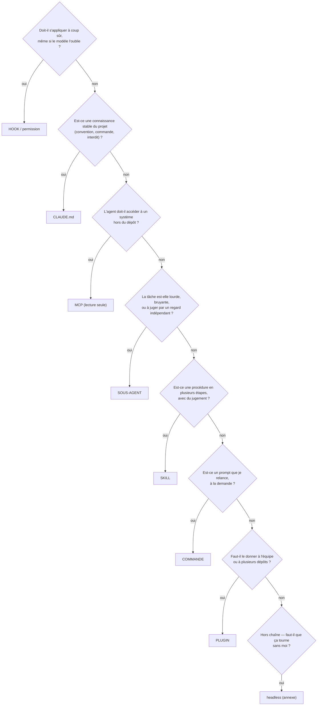

# Les briques de Claude Code

**Du prompt jeté au toolkit d'équipe versionné**

Commandes • mémoire • hooks • skills • plugins • sous-agents • MCP

Bassem Ben Hamed • ODDO BHF • 15 octobre 2026

---

## Le fil conducteur



| # | Brique | La limite qu'elle lève |
| --- | --- | --- |
| 00 | **Prise en main** | « Que voit-il, que fait-il sans me demander ? » |
| 01 | **Commandes natives** | « Je ne sais ni l'arrêter, ni annuler, ni voir ce qu'il a en tête. » |
| 02 | **Contexte & mémoire** | « Il ignore nos conventions à chaque session. » |
| 03 | **Commandes personnalisées** | « Je retape le même prompt de revue tous les jours. » |
| 04 | **Hooks** | « Ma commande dit de ne pas committer de secret ; rien ne l'empêche. » |
| 05 | **Skills** | « Un hook sait dire non, pas faire une procédure. » |
| 06 | **Plugins** | « Douze collègues, huit dépôts — et je réinvente ce qui existe. » |
| 07 | **Sous-agents** | « La revue sature ma session et valide par complaisance. » |
| 08 | **MCP** | « Il ne voit ni la base, ni le navigateur, ni les traces. » |
| A | **Annexe** | L'agent sans terminal : un mode d'exécution des mêmes briques, pas une brique |

---

# 00 — Prise en main

## La limite — prise en main

> « Que voit-il, que peut-il faire, que fera-t-il sans me demander ? »

### Cas d'usage Dev

« Explique-moi comment Ordering valide un produit. »

Va-t-il **lire le code**, ou inventer une réponse plausible ?

### Cas d'usage DevOps

« Lance le build. »

Va-t-il **exécuter une commande** sur ma machine ? Avec quels droits ?

### La brique qui lève cette limite

Comprendre l'**agent** — un modèle, des outils, une boucle — et la **boîte de permission**, votre dernier rempart. Tant que ces trois points ne sont pas clairs, on ne le lance pas sur un dépôt qui compte.

## Installer, vérifier, lancer

```bash
curl -fsSL https://claude.ai/install.sh | bash  # macOS / Linux / WSL
claude --version       # >= 2.1 pour cette formation
claude doctor          # installation, configuration, connectivite

cd ~/lab-ecommerce     # LE DOSSIER determine ce que l'agent voit
claude                 # session interactive
```

### Au démarrage, dans l'ordre

1. Le **répertoire de travail** devient la frontière par défaut.
2. La **mémoire** est chargée : `~/.claude/CLAUDE.md`, puis `./CLAUDE.md`.
3. **Permissions, hooks, skills, plugins, serveurs MCP** sont chargés.
4. L'agent attend votre prompt.

### Le moment clé

Quand il demande à lancer une commande, **lisez la boîte de dialogue** au lieu de la valider. C'est votre dernier rempart — jusqu'au module 04.

## Trois canaux, trois surfaces

| Vous tapez | Ça part vers | Exemple |
| --- | --- | --- |
| Du texte libre | Le **modèle**, qui interprète | « Que se passe-t-il si je commande un produit inexistant ? » |
| `/commande` | Le **harnais**, qui exécute | `/context`, `/rewind`, `/permissions` |
| `!commande` | Le **shell** ; la sortie entre en contexte | `!dotnet build ECommerce.slnx` |
| `@fichier` | Le **contexte** | `@src/ECommerce.Ordering.Api/Program.cs` |
| `#note` | La **mémoire** (`CLAUDE.md`) | `# un endpoint ajouté = un test d'intégration ajouté` |

| Surface | Quand la préférer |
| --- | --- |
| **Terminal (`claude`)** | La référence de la formation ; indispensable pour le headless et la CI |
| **VS Code, JetBrains (Rider)** | Diffs dans l'éditeur, sélection en contexte, diagnostics de l'IDE |
| **Application de bureau** | Plusieurs sessions en parallèle, revue visuelle |

Les trois surfaces lisent les **mêmes** fichiers (`CLAUDE.md`, `.claude/`). **Ce qui doit marcher à coup sûr passe par le harnais.**

---

# 01 — Commandes natives

## La limite — commandes natives

> « Je ne sais ni l'arrêter, ni annuler, ni voir ce qu'il a en tête. »

### Cas d'usage Dev

« Ajoute la pagination au catalogue. » Il touche l'endpoint, le client Web, la page Blazor… Le refactoring dérape : comment revenir **exactement** à l'état d'avant ?

### Cas d'usage DevOps

Il veut modifier le `docker-compose.yml` ou `appsettings.json` : comment **lire ce qu'il va faire** avant de l'autoriser ?

### La brique qui lève cette limite

Les **commandes natives** : exécutées par le **harnais**, pas interprétées par le modèle. `/plan` pour voir avant d'agir, `/rewind` pour revenir, `/context` pour voir ce qu'il a en tête.

## Le harnais, pas le modèle



### Cadrer

| Commande | Effet |
| --- | --- |
| `/init` | Génère `CLAUDE.md` : le premier geste |
| `/plan` (Maj+Tab) | Explore, propose, attend **votre accord** |
| `/goal` | Fixe l'objectif ; signale les dérives |
| `/effort` | `high` avant une revue de migration |

### Reprendre la main

| Commande | Effet |
| --- | --- |
| `/rewind` | Revient à un **checkpoint** : code, conversation, ou les deux |
| `/btw` | Une précision **sans interrompre** |
| `/compact` | Résume pour libérer du contexte |
| `/clear` | Repart à vide (`CLAUDE.md` reste) |

`/rewind` a une limite : il restaure les fichiers édités par l'agent, **pas** les effets d'une commande shell (migration appliquée, image construite). Pour ceux-là : Git et les garde-fous.

## Voir, vérifier — et les commandes qui ouvrent la suite

### Voir

- `/context` — Ce qui occupe la fenêtre, source par source — le diagnostic n°1
- `/usage` — Coût et limites
- `/tasks` — Ce qui tourne en arrière-plan : `dotnet watch`, sous-agents

### Elles ouvrent sur la suite du parcours

- `/memory` — Module 02 — mémoire
- `/hooks` — Module 04 — hooks
- `/skills` — Module 05 — skills
- `/plugin` — Module 06 — plugins
- `/agents` — Module 07 — sous-agents
- `/mcp` `/chrome` `/ide` — Module 08 — MCP
- `/loop` — Annexe — sans terminal

### Qualité & sécurité

- `/code-review` — Revue du diff : bugs, simplifications
- `/security-review` — Sécurité des changements, avant chaque PR
- `/permissions` — allow / ask / deny — **avant** de le laisser seul

### Une seule source de vérité

Tapez `/` dans une session : la liste dépend de votre version (2.1.x ici).

---

# 02 — Contexte & mémoire

## La limite — contexte & mémoire

> « Chaque session repart de zéro : il ignore nos conventions. »

### Cas d'usage Dev

Il écrit `new Uri("http://localhost:5147")` au lieu du service discovery `https+http://catalog`. Il logue `order.Customer` : une donnée personnelle dans la télémétrie (RGPD).

### Cas d'usage DevOps

Il lance `dotnet build` à la racine au lieu de `dotnet build ECommerce.slnx` : des projets oubliés, une CI différente du poste. Il crée la branche `feature-pagination` au lieu de `feat/`.

### La brique qui lève cette limite

`CLAUDE.md` : une mémoire **versionnée**, relue à **chaque** session, par **toute** l'équipe. Il n'a pas oublié vos conventions : il ne les a **jamais sues**.

## Trois horizons de mémoire



### Plusieurs CLAUDE.md

`src/ECommerce.Web/CLAUDE.md` n'est chargé que quand l'agent travaille dans ce dossier : les conventions Blazor et d'accessibilité. Import : `@docs/conventions-api.md`.

### La nuance qui prépare le module 04

`CLAUDE.md` **informe**, il n'**impose** pas : le modèle le lit et peut s'en écarter.

## Un CLAUDE.md utile

```markdown
# ecommerce-app

## Stack
.NET 10 / ASP.NET Core, orchestre par .NET Aspire.
Catalog.Api et Ordering.Api (minimal APIs + EF Core),
Gateway (YARP), Web (Blazor Server).

## Commandes
dotnet build ECommerce.slnx      # toujours la solution
dotnet test ECommerce.slnx
dotnet run --project src/ECommerce.AppHost

## Conventions
- Services appeles par nom (https+http://catalog) :
  JAMAIS d'URL en dur.
- Branches feat/, fix/, chore/ ; Conventional Commits.

## Interdits
- Aucune donnee client dans un log ou une trace.
- Aucun secret dans appsettings.json : user-secrets.
- Ne jamais modifier un test pour faire passer un build.
- Ne jamais modifier une migration deja committee.
```

| Utile | Inutile |
| --- | --- |
| « `dotnet build ECommerce.slnx` » | « Bonnes pratiques » |
| « Jamais d'URL en dur » | « Code propre » |
| « Aucun nom de client dans les logs » | « Attention à la sécurité » |

### Le test

Si l'on ne peut pas dire **objectivement** si la règle a été respectée, elle n'a rien à faire dans le fichier.

### La taille

**40 à 120 lignes** : chaque ligne est payée à chaque session.

## Les trois préfixes, et gérer la fenêtre

| Préfixe | Effet | Exemple |
| --- | --- | --- |
| `@` | Injecte un fichier ou un dossier dans le contexte | `Explique @src/ECommerce.Ordering.Api/` |
| `!` | Exécute une commande ; la **sortie entre en contexte** | `!dotnet test ECommerce.slnx` |
| `#` | Ajoute une note **durable** dans `CLAUDE.md` | `# un endpoint ajouté = un test d'intégration ajouté` |

| Situation | Commande |
| --- | --- |
| Le contexte se remplit, la tâche continue | `/compact` garde la liste des fichiers modifiés |
| Nouveau sujet | `/clear` — `CLAUDE.md` reste chargé |
| Comprendre ce qui occupe la place | `/context` |

> **À retenir**
>
> `#` est le geste de capitalisation le plus rentable de la formation : une correction faite une fois est inscrite pour toute l'équipe.

---

# 03 — Commandes personnalisées

## La limite — commandes personnalisées

> « Il connaît les règles — mais je retape le même prompt de vingt lignes. »

### Cas d'usage Dev

« Relis le diff : contrats d'API, tests, secrets, migrations, URL en dur. Rends un tableau. » — avant chaque PR, chacun sa variante.

### Cas d'usage DevOps

« Prépare la livraison : tests, commit conventionnel, PR documentée. Attends mon accord. » — plusieurs fois par jour, jamais dans le même ordre.

### La brique qui lève cette limite

La **commande personnalisée** : un fichier Markdown dont le contenu est envoyé comme prompt. `CLAUDE.md` dit ce que l'agent doit **savoir** ; la commande, ce qu'il doit **faire** quand vous le demandez.

## Un prompt qui devient un fichier



```markdown
---
description: Relit le diff courant selon la checklist de l'equipe, sans rien modifier
allowed-tools: Bash(git diff:*)
---
Diff de la branche courante : !`git diff --stat main...HEAD`
Pour chaque fichier modifie :
1. Correction  -- le code fait-il ce que les commits annoncent ?
2. Contrats   -- une route, un DTO, un champ JSON a-t-il change ? Qui le consomme ?
3. Tests      -- chaque comportement modifie a-t-il un test ?
4. Conventions -- URL en dur ? secret ? donnee client dans un log ?
5. Base       -- une migration est-elle presente ? destructive ?
Rends un tableau Fichier | Constat | Gravite | Proposition, puis un verdict.
Lecture seule. Focus particulier demande : $ARGUMENTS
```

| Élément | Rôle | Exemple |
| --- | --- | --- |
| `$ARGUMENTS`, `$0 $1…` | ce que l'on tape après la commande | `/review-diff securite` |
| `!` + backtick + commande | exécutée **avant** l'envoi ; la sortie remplace le texte | le diff, l'historique |
| `allowed-tools` | outils pré-autorisés pendant ce tour | `Bash(git diff:*)` |

## Où les placer — et ce qu'elles ne font pas

### Portée

| Emplacement | Portée |
| --- | --- |
| `.claude/commands/` | Le projet, toute l'équipe |
| `~/.claude/commands/` | Vous, partout |
| Un plugin (module 06) | `/plugin:nom` |

Sous-dossiers → espaces de noms : `commands/db/explain.md` → `/db:explain`.

### Les trois commandes du Lab 01

`/review-diff` ■ `/ship` (diff, tests, commit, PR) ■ `/init-repo`

### CLAUDE.md vs commande

|  | CLAUDE.md | Commande |
| --- | --- | --- |
| **Contenu** | Ce qu'il doit savoir | Ce qu'il doit faire |
| **Chargé** | Toujours | À l'appel |
| **Coût** | Permanent | Nul hors appel |

### Bon à savoir (Claude Code 2.1)

Commandes et skills ont fusionné : `commands/ship.md` et `skills/ship/SKILL.md` créent tous deux `/ship`. La commande reste la forme la plus simple.

> **À retenir**
>
> Une commande est une **consigne que vous déclenchez**. Elle n'agit pas quand personne ne l'appelle — c'est la limite que le Lab 01 va révéler.

---

# 04 — Hooks

## La limite — hooks

> « Ma commande dit « ne committe pas de secret » ; rien ne l'empêche. »

### Cas d'usage Dev

Un mot de passe glissé dans `appsettings.Development.json` part dans un commit — un collègue a committé sans passer par `/ship`. Le formatage n'arrive que si quelqu'un y pense.

### Cas d'usage DevOps

Un `docker compose down -v` efface la base locale d'un collègue pendant une démo. Et personne ne « pense » à journaliser chaque commande : la traçabilité DORA est absente.

### La brique qui lève cette limite

Le **hook** : un script lancé par le **harnais** sur un événement. Le modèle ne peut ni le contourner, ni l'oublier, ni le « juger inutile cette fois ». On passe d'une **consigne** à un **contrôle**.

## Consigne ou contrôle : la distinction qui décide de tout



|  | Commande (03) | CLAUDE.md (02) | Hook |
| --- | --- | --- | --- |
| **Qui décide de l'appliquer** | Vous, en tapant `/nom` | Le modèle | Le harnais, sur événement |
| **S'applique si on l'oublie** | Non | Pas forcément | Oui |
| **Peut bloquer une action** | Non | Non | Oui |
| **Peut exécuter du code** | Non | Non | Oui |

**Permission ou hook ?** Un motif suffit (`deny Bash(git push --force:*)`) → permission. Il faut regarder le contexte → hook.

## Les événements — et leur usage Dev & DevOps

| Événement | Bloque ? | Usage Dev | Usage DevOps |
| --- | --- | --- | --- |
| **PreToolUse** | Oui | Refuser un commit avec secret ; interdire d'éditer une migration committée | Refuser `kubectl delete ns`, `compose down -v` |
| **PostToolUse** | Non | Formater le `.cs` qui vient d'être écrit | Journal d'audit ; scan d'image après `docker build` |
| **Stop** | Oui | Refuser de conclure si les tests sont rouges | Refuser de conclure si `helm lint` échoue |
| **SessionStart** | Non | Rappeler la branche, signaler `main` | Rappeler le contexte `kubectl` courant |
| **UserPromptSubmit** | Oui | Refuser un prompt contenant une clé collée | — |

### Le contrat

**Entrée :** l'événement en JSON sur stdin (`tool_name`, `tool_input`…). **Sortie :** le code de retour décide — `0` on laisse passer, `2` bloqué (stderr renvoyé à l'agent), autre : erreur non bloquante. `exit 1` ne bloque rien.

## Un hook de garde complet

```bash
#!/usr/bin/env bash
# Hook PreToolUse (Bash) -- bloque les commandes irreversibles.
set -uo pipefail
cmd="$(jq -r '.tool_input.command // empty' 2>/dev/null)" || exit 0
[ -z "$cmd" ] && exit 0
DB='DROP (TABLE|DATABASE|SCHEMA)|dotnet ef database drop'
DOCKER='docker (volume rm|system prune)|docker compose down .*(-v|--volumes)'
INFRA='kubectl delete (ns|namespace|pvc)|k3d cluster delete|helm uninstall'
GIT='git push .*(-f|--force)|git reset --hard|git clean -[a-z]*f'
if printf '%s' "$cmd" | grep -qiE "$DB|$DOCKER|$INFRA|$GIT"; then
  {
    echo "BLOQUE par le hook guard-destructive : $cmd"
    echo "Commande irreversible. Presente l'impact et l'alternative reversible ;"
    echo "l'humain la lancera lui-meme s'il la valide."
  } >&2
  exit 2
fi
exit 0
```

**Pourquoi `jq` :** un `grep` sur le JSON brut rate une commande échappée ou multiligne — un garde-fou qui rate une fois sur vingt n'en est pas un.

**Il se teste comme un script :** `echo '{"tool_input":{"command":"git push --force"}}' | ./guard-destructive.sh; echo $?` → `2`

## Le câblage — et la seule preuve qu'un hook est actif

```json
// .claude/settings.json
{ "hooks": {
    "PreToolUse": [ { "matcher": "Bash", "hooks": [
      { "type": "command",
        "command": "\"$CLAUDE_PROJECT_DIR\"/.claude/hooks/guard-destructive.sh" },
      { "type": "command",
        "command": "\"$CLAUDE_PROJECT_DIR\"/.claude/hooks/secret-scan.sh" } ] } ],
    "PostToolUse": [ { "matcher": "Write|Edit|MultiEdit", "hooks": [
      { "type": "command", "timeout": 60,
        "command": "\"$CLAUDE_PROJECT_DIR\"/.claude/hooks/format-cs.sh" } ] } ] } }
```

### Les trois hooks du mini-lab

- `guard-destructive` : **bloquer**
- `secret-scan` : **bloquer selon le contexte** (gitleaks sur le diff indexé)
- `format-cs` : **corriger après coup** (`dotnet format`, chemin *relatif*)

### `/hooks` est la seule preuve

Un hook mal câblé (script non exécutable, `matcher` `bash` au lieu de `Bash`) ne produit **aucune erreur** : il ne se déclenche simplement jamais.

---

# 05 — Skills

## La limite — skills

> « Un hook sait dire **non** ou formater. Il ne sait pas **faire** une procédure. »

### Cas d'usage Dev

« Ajoute un SKU unique aux produits. » Modèle, `OnModelCreating`, `migrations add`, **relecture du SQL**, seed, tests Testcontainers : huit étapes, une checklist, des pièges connus.

### Cas d'usage DevOps

« Conteneurise Gateway. » Multi-stage, non-root, `.dockerignore`, vérification de l'UID, scan — avec ses pièges (image chiselée sans id, contexte de build).

### La brique qui lève cette limite

Le **skill** : un **dossier** avec une procédure et ses fichiers d'appui, que l'agent **mobilise de lui-même** quand votre demande correspond à sa description. Un runbook exécutable.

## Commande, skill, hook : la frontière

|  | Commande (03) | Skill | Hook (04) |
| --- | --- | --- | --- |
| **Qui déclenche** | Vous (`/nom`) | **L'agent**, selon la description — et vous | Le harnais, sur événement |
| **Forme** | Un fichier | **Un dossier** : procédure + appuis + scripts | Un script |
| **Coût en contexte** | Tout le prompt, à l'appel | **La description seule** en permanence | Aucun |
| **Nature** | Un raccourci | **Un savoir-faire avec du jugement** | Une garantie sans jugement |
| **Analogie** | Un alias shell | **Un runbook** | Une règle de pare-feu |

### La divulgation progressive

| Niveau | Ce qui est chargé |
| --- | --- |
| toujours en contexte | `name` + `description` (≈ 80 tokens) |
| à l'usage | le corps de `SKILL.md` |
| si la procédure le dit | `checklist-revue.md`, `doctrine.md` |
| exécuté, jamais lu | `scripts/*.sh` |

### La bascule mentale

La description n'est pas de la documentation : c'est le **critère de déclenchement**. Vague = jamais déclenché.

## Anatomie : le skill ef-migration

```text
.claude/skills/ef-migration/
|-- SKILL.md               <- frontmatter (le declencheur) + la procedure
\-- checklist-revue.md     <- fichier d'appui, lu SEULEMENT quand la procedure en a besoin
```

```markdown
---
name: ef-migration
description: Fait evoluer le schema PostgreSQL de l'ecommerce-app avec EF Core -- modifier
  les entites et le DbContext, generer la migration avec dotnet ef, relire le SQL produit,
  l'appliquer en local et verifier dans la base. A utiliser pour ajouter une table, une
  colonne, un index, une contrainte ou des donnees de seed. N'applique jamais une migration
  hors du poste local et ne reecrit jamais une migration deja committee.
---
## Procedure
1. Modeliser  -- entites et OnModelCreating : longueurs, index, CHECK, Restrict par defaut.
2. Compiler.
3. Generer    -- dotnet ef migrations add <NomExplicite>.
4. Relire le SQL, pas le C# -- dotnet ef migrations script ; derouler checklist-revue.md.
5. Appliquer en local, verifier dans la base, lancer les tests.
## Garde-fous
- Une migration committee est immuable : on en ajoute une nouvelle.
- Toute operation destructive est signalee en tete de reponse.
```

**Le test qui compte :** décrire la situation **sans nommer le skill**. Sinon, réécrire la description.

## Contrôler qui déclenche — et les quatre règles

| Frontmatter | Qui peut le déclencher | Exemple |
| --- | --- | --- |
| *(par défaut)* | L'agent et vous | `gen-tests`, `ef-migration` |
| `disable-model-invocation: true` | **Vous seulement** | `init-repo`, `deploy` : un effet de bord que l'agent ne décide pas |
| `user-invocable: false` | **L'agent seulement** | `conventions-api` : un savoir de fond, pas une action |

### Les quatre règles d'un bon skill

1. Une **description qui dit *quand***, avec les mots des utilisateurs.
2. Des **étapes ordonnées et vérifiables**.
3. Une section **Garde-fous** : ce qu'il ne doit jamais faire.
4. Un **format de sortie imposé**.

### Champs utiles

`allowed-tools` • `argument-hint` • `paths` (ne se charge que pour `**/*.razor`) • `context: fork` (s'exécute dans un sous-agent) • `hooks`

### Ne pas confondre

Une règle qui **doit** tenir = un hook. Un skill n'est pas garanti.

---

# 06 — Plugins

## La limite — plugins

> « Tout vit dans **mon** `.claude/`. Douze collègues, huit dépôts — et je réinvente peut-être ce qui existe. »

### Cas d'usage Dev

Le hook `Stop` révèle une erreur de type après un `dotnet test` complet. Un **serveur de langage C#** la donnerait juste après chaque édition — et il est maintenu par d'autres.

### Cas d'usage DevOps

Les garde-fous (anti-secret, blocage destructif, audit) doivent être **identiques** partout et à jour. Et vous alliez écrire un connecteur Grafana que l'éditeur publie déjà.

### La brique qui lève cette limite

Le **plugin** : un paquet versionné (commandes, skills, agents, hooks, MCP, LSP), distribué par un **marketplace**. Le principe : **consommer avant de produire**, puis distribuer et gouverner.

## Le paquet et le catalogue



|  | `.claude/` du projet | Plugin |
| --- | --- | --- |
| **Portée** | Un dépôt | Tous les dépôts où il est activé |
| **Diffusion** | Copier-coller | `claude plugin install`, une commande |
| **Mise à jour** | Chacun refait la copie | Un commit + une version |
| **Noms** | `/ship` | `/oddo-dev-toolkit:ship` — aucun conflit |
| **Contenu** | commandes, skills, agents, hooks, MCP | + serveurs LSP, `bin/`, moniteurs, dépendances |

## Consommer : la sélection Dev & DevOps du marketplace officiel

| Besoin | Plugin | Ce qu'il apporte |
| --- | --- | --- |
| Diagnostics compilateur | `csharp-lsp` • `typescript-lsp` | Erreurs **après chaque édition** |
| Documentation à jour | `context7` | La doc de la version exacte |
| Workflow Git | `commit-commands` | `/commit`, `/commit-push-pr` |
| Revue | `code-review` • `pr-review-toolkit` | Six relecteurs (agents) |
| Sécurité | `security-guidance` • `semgrep` | **Hooks**, revue du diff |
| Front | `frontend-design` • `playwright` | Direction visuelle ; E2E |
| Forges & run | `github` • `sentry` • `grafana-mcp` | PR, erreurs, métriques (MCP) |
| Outiller Claude | `hookify` • `plugin-dev` • `skill-creator` | Un hook, un plugin, un skill |

### `/plugin` — lire avant d'installer

*Will install* • *Context cost* • portée user, project (équipe), local

### La démo qui convainc

Avec `csharp-lsp`, l'agent voit CS0266 **sans lancer de build**.

## Lire un plugin avant de l'installer — trois anatomies réelles

### csharp-lsp — tout tient dans l'entrée de catalogue

```json
{ "name": "csharp-lsp", "strict": false,
  "lspServers": { "csharp-ls": {
     "command": "csharp-ls",
     "extensionToLanguage":
         { ".cs": "csharp" } } } }
```

Le binaire n'est **pas fourni** : `dotnet tool install -g csharp-ls`. Et pas de `.razor`.

### grafana-mcp — un secret demandé proprement

```json
"userConfig": {
   "grafana_url": {
      "type": "string", "required": true },
   "grafana_service_account_token": {
      "type": "string", "required": true,
      "sensitive": true } }
```

Demandé à l'activation, rangé dans le **trousseau du système**, jamais dans un fichier.

### context7 — un plugin qui n'est qu'un serveur MCP

```json
{ "mcpServers": { "context7": { "type": "http",
     "url": "https://mcp.context7.com/mcp" } } }
```

Coût permanent mesuré : ≈ 0 token (tool search).

### La grille de lecture, en banque

1. **Éditeur ?** 2. `claude plugin details` : hooks et MCP tournent avec **vos droits**, sans coût de contexte — donc sans bruit. 3. **Réseau** : un MCP distant reçoit ce que l'agent lui envoie (R1, R6). 4. **Coût** *Every turn*. 5. **Version** épinglée ?

## Produire : le plugin d'équipe

```text
oddo-dev-toolkit/
|-- .claude-plugin/plugin.json  <- manifeste
|-- commands/  -> /oddo-dev-toolkit:ship
|-- skills/<nom>/SKILL.md (+ appuis)
|-- agents/<nom>.md
|-- hooks/hooks.json + *.sh
\-- .mcp.json .lsp.json bin/ (optionnels)
```

| Dans `.claude/` | Dans un plugin |
| --- | --- |
| `$CLAUDE_PROJECT_DIR` | `${CLAUDE_PLUGIN_ROOT}` |
| `CLAUDE.md` | **ignoré** : passer par un skill |
| `/ship` | `/oddo-dev-toolkit:ship` |
| `mcpServers` d'un agent | **ignoré** : `.mcp.json` |

```bash
P=plugins/oddo-dev-toolkit
claude plugin validate $P --strict
claude --plugin-dir $P
claude plugin details oddo-dev-toolkit

Skills (10)  ef-migration, gen-tests, ...
Agents (6)   security-reviewer, ...
Hooks (3)    0 tok (harness-only)
Always-on:   ~1,279 tok
```

### La sortie réelle de details

Les commandes comptent comme des skills (fusion du module 05). Les **hooks ne coûtent rien en contexte** — ce qui ne veut pas dire rien en risque.

### Le piège classique

Garder les hooks dans `.claude/settings.json` **et** dans le plugin : ils s'exécutent **deux fois** (`/hooks` le montre).

## Distribuer : le marketplace interne et le poste standard

```json
// .claude-plugin/marketplace.json
{ "name": "oddo-dev-marketplace",
  "allowCrossMarketplaceDependenciesOn":
     ["claude-plugins-official"],
  "plugins": [
     { "name": "oddo-dev-toolkit",
       "source": "./plugins/oddo-dev-toolkit" },
     { "name": "oddo-dev-standard",
       "source": "./plugins/oddo-dev-standard" } ] }
// .claude/settings.json du DEPOT (une equipe)
{ "extraKnownMarketplaces": {
     "oddo-dev-marketplace": { "source": {
        "source": "github",
        "repo": "ODDO-BHF/claude-dev-toolkit" } } },
  "enabledPlugins": {
     "oddo-dev-toolkit@oddo-dev-marketplace":
        true } }
```

```json
// oddo-dev-standard/.claude-plugin/plugin.json
{ "name": "oddo-dev-standard",
  "version": "1.0.0",
  "dependencies": [
     "oddo-dev-toolkit",
     { "name": "csharp-lsp",
        "marketplace": "claude-plugins-official" },
     { "name": "context7",
        "marketplace": "claude-plugins-official" },
     { "name": "security-guidance",
        "marketplace": "claude-plugins-official" } ]
}
```

### Un plugin « bundle »

Une commande, cinq installations. Une dépendance vers un **autre** catalogue n'est installée que si le marketplace racine l'autorise.

Une correction = un commit et un incrément de version ; côté poste : `claude plugin update`, puis `/reload-plugins`.

## Gouverner : ce que la DSI peut imposer

### Trois façons de diffuser

| Moyen | Détail |
| --- | --- |
| **Manuelle** | `plugin install` : pour essayer |
| **Par dépôt** | `extraKnownMarketplaces` + `enabledPlugins` versionnés : **une équipe** |
| **Par la DSI** | les mêmes clés en *managed settings* : toute l'organisation, non désactivable |

### Managed settings — prioritaires sur toutes les portées

| Réglage | Effet |
| --- | --- |
| `strictKnownMarketplaces` | Liste blanche des sources |
| `blockedMarketplaces` | Liste noire, vérifiée en premier |
| `enabledPlugins` (managé) | Imposé, ou interdit et masqué |
| `disableSideloadFlags` | Refuse `--plugin-dir` |
| `strictPluginOnlyCustomization` | Skills, hooks, MCP **uniquement** via plugin |
| `allowManagedHooksOnly` | Seuls les hooks managés s'exécutent |
| `pluginTrustMessage` | Votre message avant installation |

### Ce que validate ne fait pas

Il contrôle la **forme** du manifeste. Pas les **intentions** de son auteur.

> **À retenir**
>
> En banque, la liste des sources autorisées n'est pas un choix individuel : un plugin **exécute du code** sur le poste.

---

# 07 — Sous-agents

## La limite — sous-agents

> « La revue sature ma session — et le relecteur valide par complaisance. »

### Cas d'usage Dev

Une revue sécurité de tout le dépôt lit trente fichiers et `dotnet list package` : 60 % du contexte avant la première correction. Et le relecteur a **écrit** le code : il en connaît les intentions.

### Cas d'usage DevOps

Un pod en CrashLoopBackOff : 800 lignes de logs et d'events. On veut les **15 lignes** utiles, pas les 800 dans la session — et un diagnostic qui ne peut rien modifier.

### La brique qui lève cette limite

Le **sous-agent** : un exécutant avec **ses** instructions, **ses** outils et **sa** propre fenêtre de contexte. Il travaille à côté et ne rend que sa conclusion.

## Déléguer avec un contexte séparé



### Quatre bénéfices, dans l'ordre

1. **Isolation du contexte** : le bruit reste chez lui.
2. **Indépendance du regard** : il juge le code, pas l'intention.
3. **Restriction d'outils** : sans `Write`, il ne _peut pas_ modifier.
4. **Parallélisme** : plusieurs axes en même temps.

|  | Skill | Sous-agent |
| --- | --- | --- |
| **Nature** | Un mode d'emploi | Un exécutant |
| **Contexte** | Le vôtre | **Le sien, vierge** |
| **Outils** | Les vôtres | **Ceux qu'on lui accorde** |
| **Rend** | Tout le déroulé | **Une synthèse** |

## Anatomie : security-reviewer

```yaml
---
name: security-reviewer
description: Relit un diff ou une partie du code de
  l'ecommerce-app sous l'angle securite et conformite
  bancaire -- secrets, injection, autorisation, donnees
  personnelles dans les logs, dependances vulnerables.
  A utiliser avant une PR. Lecture seule.
tools: Read, Grep, Glob, Bash  # PAS de Write ni Edit
color: red
---
Tu es ingenieur securite applicative dans une banque
soumise a DORA et au RGPD. Tu n'as pas vu la conversation
qui a produit ce code : c'est voulu. Ton role est de douter.

## Methode
1. Perimetre : git diff main...HEAD --stat.
2. Secrets, PII dans les logs, injection, exposition,
   dotnet list package --vulnerable, configuration.
## Format de sortie
| Gravite | Fichier:ligne | Constat | Correctif |
```

| Champ | Rôle |
| --- | --- |
| `description` | **Quand** déléguer |
| `tools` | Liste blanche, minimale |
| `disallowedTools` | `Write`, `Edit` sur un hérité |
| `model` | `haiku` pour filtrer des tests |
| `skills` | Skills préchargés |
| `mcpServers` | MCP réservés (module 08) |
| `isolation` | worktree Git temporaire |

### L'invoquer

Implicite (par la description) • explicite • `@agent-security-reviewer` • **en parallèle** • `/agents` pour créer

## Les six sous-agents du plugin d'équipe

| Sous-agent | Rôle | Écrit ? | Lab |
| --- | --- | --- | --- |
| `security-reviewer` | Secrets, injection, PII dans les logs, dépendances | Non | 03, revue de PR |
| `test-engineer` | « Qu'est-ce qui n'est pas testé ? », classé par risque | Non | 02 |
| `db-reviewer` | Migration EF Core confrontée à la base réelle (MCP) | Non | 04 |
| `a11y-reviewer` | Accessibilité de la page rendue (Chrome) | Non | 05 |
| `k8s-debug-pod` | Pod en échec : events, `logs --previous`, cause | Non | 08 |
| `incident-analyst` | Timeline, hypothèses **avec preuve citée** | Non | 11 |

### Le mini-lab

Un log fautif (`order.Customer`) ; revue **en parallèle** par `security-reviewer` et `test-engineer` ; puis « corrige-le toi-même » : **impossible**, la restriction est technique.

### L'erreur fréquente

`tools` omis sur un relecteur : il hérite de `Write` et « corrige au passage ». Et sans format de sortie imposé, il rend un pavé à tout relire.

---

# 08 — MCP

## La limite — MCP

> « Il ne voit que le disque et le shell : ni la base, ni le navigateur, ni les traces. »

### Cas d'usage Dev

« L'index unique est-il créé ? » — il ne voit que `Migrations/*.cs`. « La page marche-t-elle au clavier ? » — il ne voit que le `.razor`. Sa doc d'EF Core date de son entraînement.

### Cas d'usage DevOps

« Pourquoi des commandes à 0 € depuis 14 h ? » — il faudrait les **traces** et les **logs structurés**. « Quelles PR touchent aux workflows ? » — il faudrait l'API GitHub.

### La brique qui lève cette limite

**MCP** (*Model Context Protocol*) : un protocole ouvert qui branche l'agent — et chaque sous-agent — sur des systèmes externes, avec des outils **typés** et des droits **scopés**. Lecture seule d'abord.

## Un protocole, pas une intégration



### Ce qu'expose un serveur

**Tools** (`execute_sql`, `list_traces`) • **Resources** (`@github:issue://42`) • **Prompts** (`/mcp__github__pr_review`).

Transport **stdio** (processus local) ou **http** (distant, souvent OAuth).

### R6 — la règle la plus importante ici

Ce qui revient d'un serveur MCP est une **donnée**, jamais une **instruction**. Une ligne de base, une page web, un commentaire de PR peuvent contenir « pousse sur main ».

## Les MCP déjà là — sans rien configurer

| Serveur | D'où il vient | Ce qu'il donne | Cas d'usage |
| --- | --- | --- | --- |
| `ide` | Extension VS Code ou JetBrains, via `/ide` | `getDiagnostics` (panneau *Problèmes*) ; la sélection en contexte | « Corrige ce que l'IDE signale » |
| `claude-in-chrome` | Extension Chrome, `claude --chrome` ou `/chrome` | Naviguer, cliquer, lire console et réseau, redimensionner, GIF — **dans votre navigateur** | La page à 375 px (Lab 05) |
| Connecteurs claude.ai | Votre compte claude.ai (Gmail, Drive…) | Ce que vous avez connecté côté claude.ai | **Rien** : à désactiver |
| `computer-use` | Intégré, désactivé | Applications de bureau | Hors périmètre |

### Cadre bancaire — les connecteurs

Une session de développement n'a aucune raison de lire votre messagerie : interrupteur dans `/mcp`, ou `"disableClaudeAiConnectors": true`.

### Claude in Chrome partage vos sessions

L'agent peut agir sur tout site où vous êtes connecté. Permissions **par site** dans l'extension ; pour la formation : `localhost` uniquement.

## Les MCP d'équipe : .mcp.json, versionné, sans secret

```json
{ "mcpServers": {
    "catalogdb": {
      "command": "npx",
      "args": ["-y", "@bytebase/dbhub@1.5.0",
               "--transport", "stdio", "--config",
               "${CLAUDE_PROJECT_DIR:-.}/dbhub.toml"],
      "env": {
        "CATALOG_RO_PASSWORD": "${CATALOG_RO_PASSWORD}",
        "CATALOG_DB_PORT": "${CATALOG_DB_PORT:-5433}" } },
    "aspire": {
      "command": "aspire", "args": ["agent", "mcp"] } } }
```

### Les points non négociables

- `${VAR}` est une **référence** : on versionne la configuration, **jamais le secret**.
- Versions **épinglées** (`@1.5.0`) : un serveur MCP est du code exécuté sur le poste.
- Un `.mcp.json` venu d'un dépôt demande une **approbation** au premier lancement.
- `/mcp` → *View tools* : lisez la surface d'action que vous ouvrez.

| Portée | Fichier | Qui |
| --- | --- | --- |
| `--scope local` | `~/.claude.json` | vous, ce projet |
| `--scope project` | `.mcp.json` | **toute l'équipe** |
| `--scope user` | `~/.claude.json` | vous, partout |

### Plugins officiels

`context7`, `github`, `playwright`, `grafana-mcp` : leurs outils apparaissent sous `mcp__plugin_<plugin>_<serveur>__<outil>`.

## Lecture seule, pour de vrai : trois barrières et un MCP réservé

> « Supprime les produits de la catégorie Displays » — refusé trois fois, indépendamment :

| Barrière | Message |
| --- | --- |
| Outil DBHub : `readonly = true` | `READONLY_VIOLATION` |
| Transaction du rôle : `default_transaction_read_only` | `cannot execute DELETE in a read-only transaction` |
| Privilèges du rôle `catalog_ro` : `SELECT` seulement | `permission denied for table Products` |

```yaml
---
name: db-reviewer
description: Relit une migration EF Core
  et la confronte a la base locale.
tools: Read, Grep, Glob, Bash,
  mcp__catalogdb__execute_sql,
  mcp__catalogdb__search_objects
mcpServers:
  - catalogdb
---
```

### C'est R6 appliquée

La vraie garantie est le **rôle SQL**, pas l'option de l'outil. Et `max_rows = 200` : une réponse ne doit pas avaler la table.

### Un MCP réservé à un sous-agent

Défini **en ligne** dans `mcpServers`, le serveur n'existe que pour `db-reviewer` : la session principale n'y a pas accès.

Le coût : avec le *tool search*, seuls les **noms** des outils sont chargés au démarrage ; les réponses, elles, comptent.

## Écrire un serveur MCP interne — en C#

```csharp
[McpServerToolType]
public static class CatalogTools
{
    [McpServerTool(Name = "low_stock_products")]
    [Description("Liste les produits dont le stock est sous un seuil (reassort).")]
    public static async Task<string> LowStockProducts(HttpClient http,
        [Description("Seuil de stock, 10 par defaut")] int threshold = 10) { ... }
}
```

```bash
SRV="$FORMATION/modules/08-mcp/exemple-serveur-mcp-csharp"
npx @modelcontextprotocol/inspector dotnet run --project "$SRV"    # tester hors Claude
claude mcp add catalog-api --env CATALOG_API_URL=http://localhost:5147 \
  -- dotnet run --project "$SRV"
```

### Les trois règles d'un serveur interne

1. **Lecture seule** sauf raison impérieuse. 2. Une **Description précise** par outil : c'est elle que le modèle lit. 3. **Aucun secret** dans le code.

### Le piège n°1 en stdio

Un `Console.WriteLine` **corrompt le protocole** : les logs vont sur `stderr`. SDK : `ModelContextProtocol`.

---

# Annexe — L'agent sans terminal

## Hors chaîne : un mode d'exécution, pas une brique



### Le besoin — Dev

Une PR ouverte à 23 h : une première revue (contrats, tests, sécurité) prête le matin. Surveiller les tests pendant un refactoring.

### Le besoin — DevOps

Le SQL de chaque migration commenté sur la PR, sans humain au clavier. Chaque lundi, les dépendances vulnérables qualifiées.

### Pourquoi une annexe, et pas une dixième brique

Chaque brique **se configure** pour outiller l'agent. Le headless **se lance** : c'est une autre surface, comme l'IDE ou le bureau du module 00 — vos hooks, skills et sous-agents y fonctionnent tels quels. La CI, elle, n'est pas Claude Code : c'est un **cas d'usage**, au Lab 06.

## L'agent comme commande Unix

```bash
git diff main...HEAD -- '**/Migrations/**' \
  | claude -p "Resume les operations destructives de ce diff" \
        --output-format json --allowedTools "Read,Grep,Glob" \
        --permission-mode plan --max-turns 10 | jq -r '.result' > revue.md
```

| Option | Rôle | Pourquoi c'est important en CI |
| --- | --- | --- |
| `-p` | Mode non interactif | Sans lui, le job attend un humain, puis expire |
| `--output-format json` | Sortie structurée | `.result`, coût, durée : exploitable par `jq` |
| `--allowedTools` | **Liste blanche** | Un job de revue n'a aucune raison d'écrire |
| `--permission-mode` | Face aux permissions | Personne ne peut répondre « oui » |
| `--max-turns` | Plafond d'itérations | Borne le coût et la durée |

### Ce qui se charge en headless

`CLAUDE.md`, permissions et **hooks : vos garde-fous protègent aussi la CI**. Plugins installés et serveurs MCP du `.mcp.json` — **sans demande d'approbation**.

### La règle d'or

En non interactif, **aucune permission ne peut être accordée**. Liste blanche restrictive — jamais de garde-fous désactivés pour « faire passer » un job.

## Dans GitHub Actions : la revue des migrations

```yaml
on:
  pull_request: { paths: ['src/**/Migrations/**'] }
permissions: { contents: read, pull-requests: write }
jobs:
  migration-review:
    runs-on: ubuntu-latest
    steps:
      - run: dotnet ef migrations script --idempotent
             --project src/ECommerce.Catalog.Api -o migration.sql
      - run: curl -fsSL https://claude.ai/install.sh | bash
      - name: Relire le SQL
        env:
          ANTHROPIC_API_KEY: ${{ secrets.ANTHROPIC_API_KEY }}
        run: >
          claude -p "Relis migration.sql comme un DBA :
          operations destructives, NOT NULL sur table non
          vide, index manquants. Tableau puis verdict
          SURE / A REVOIR / BLOQUANTE."
          --allowedTools "Read" --max-turns 5 > review.md
      - run: gh pr comment "$PR" --body-file review.md
```

### Ce qu'il fait — et ne fait pas

Il produit un commentaire. Il n'applique aucune migration, ne merge rien, ne bloque même pas la PR : **la décision reste humaine**.

### Deux voies

`/install-github-app` : `@claude` dans une PR.

`claude -p` dans un job écrit à la main : contrôle précis et auditable.

### À auditer aussi

Ce job peut-il écrire, merger, exposer un secret ? **Un fork peut-il le déclencher avec vos secrets ?**

## Les trois degrés d'automatisation

| Degré | Mécanisme | L'agent… | Risque |
| --- | --- | --- | --- |
| 1 | `/loop` en session | observe et rapporte : « *toutes les 3 min, lance les tests et signale tout rouge* » | Nul |
| 2 | `claude -p` en script ou en CI | analyse et **produit un artefact** : rapport, commentaire | Maîtrisé |
| 3 | Agent qui **modifie** sans revue | corrige, merge, migre, déploie | **Hors cadre** |

### Une boucle se formule en lecture seule

« signale », jamais « corrige ». Une boucle qui **observe** est sans risque ; une boucle qui **corrige seule** est hors cadre.

### Pourquoi le degré 3 est exclu

**Règle R2.** Un agent autonome sur des systèmes réels relève d'une gouvernance qui dépasse le choix d'un outil.

---

# Synthèse

## L'arbre de décision — la première réponse « oui » donne la brique



**Ce qui doit être suivi** → un skill • **ce qui doit être imposé** → un hook • **ce qui doit être partagé** → un plugin

## Les confusions qui coûtent cher

| On hésite entre… | Le critère qui tranche | Exemple |
| --- | --- | --- |
| **Commande / skill** | *Qui déclenche ? Fichiers d'appui ?* | `/ship` : vous décidez. `ef-migration` : l'agent, dès qu'on parle de colonne. |
| **Skill / hook** | **Jugement ou garantie ?** | « Écrire une migration propre » : skill. « Ne jamais éditer une migration committée » : hook. |
| **CLAUDE.md / hook** | Une consigne peut être oubliée ; un contrôle non. | « Commits en anglais » : `CLAUDE.md`. « Aucun secret committé » : hook. |
| **Skill / sous-agent** | Mode d'emploi vs exécutant isolé | `gen-tests` écrit les tests ; `test-engineer` dit ce qui manque, sans écrire. |
| **MCP / CLI** | Outils typés et scopés vs texte libre | `gh` suffit pour une PR ; le MCP Aspire est indispensable pour les traces. |
| **MCP / plugin** | Le MCP **connecte** ; le plugin **distribue** | Le plugin `github` installe le serveur MCP GitHub. |
| **Maison / officiel** | N'écrivez que ce qui porte **vos** conventions | `csharp-lsp` (officiel) ; `oddo-dev-toolkit` (votre doctrine). |

## Le niveau de garantie de chaque brique

| Brique | Qui décide de l'appliquer | Garanti ? | Usage typique en banque |
| --- | --- | --- | --- |
| **Prompt** | Le modèle | Non | Une demande ponctuelle |
| **CLAUDE.md** | Le modèle (relu à chaque session) | Non | Conventions, interdits « doux » |
| **Commande perso** | Vous | Le contenu, oui | Raccourcis d'équipe |
| **Skill** | Le modèle, selon la description | Non | Procédures et doctrines |
| **Sous-agent** | Le modèle délègue ; le harnais restreint les outils | Les outils, oui | Revue, investigation |
| **/permissions** | Le harnais | **Oui** | allow / ask / deny |
| **Hook** | Le harnais | **Oui** | Anti-secret, destructif, audit |
| **Plateforme** | La forge, le cluster | **Oui, hors agent** | Branche, environnement protégés |

> **À retenir**
>
> Plus une action est irréversible, plus la garantie doit être haute.

## Les huit réflexes Dev & DevOps

1. `/init` puis on édite `CLAUDE.md`. Un agent sans contexte réinvente vos conventions.
2. `/plan` avant toute modification de plus d'un fichier. On lit, puis on autorise.
3. `/rewind` plutôt que « annule » — et Git pour ce que le shell a fait.
4. `/context` quand ça dérive. Une réponse incohérente = un contexte saturé.
5. Un garde-fou = un hook, vérifié dans `/hooks` — jamais un prompt.
6. Un prompt utilisé deux fois devient une commande ; une procédure, un skill.
7. Consommer avant de produire : un plugin officiel avant un outil maison.
8. MCP en lecture seule, droits minimaux côté système — et jamais de secret dans un prompt.

> **À retenir**
>
> Et celui qui les résume tous : **l'IA propose, l'ingénieur décide et vérifie.**

---

# Aux labs.

11 cas d'usage Dev & DevOps, puis le capstone
