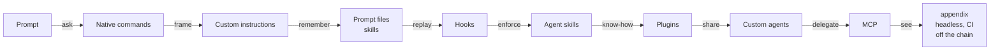
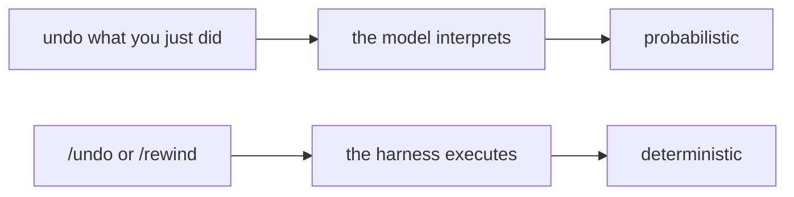
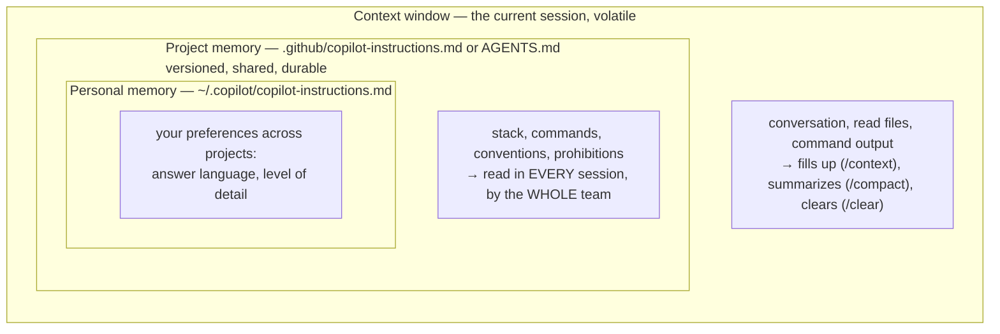
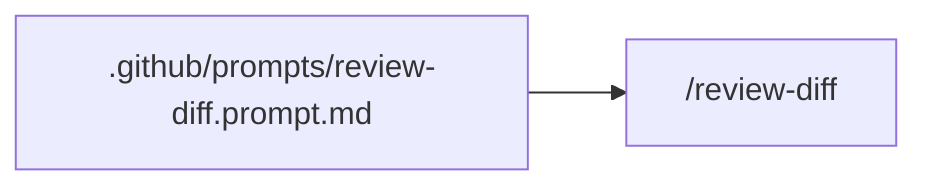
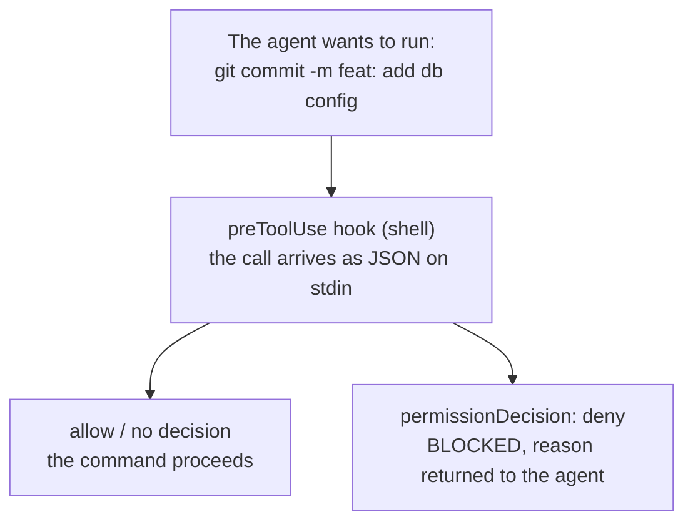
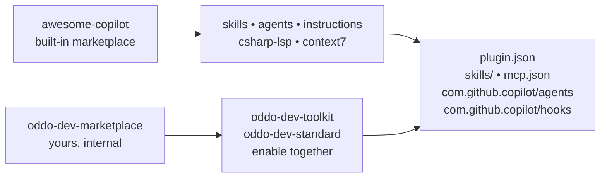
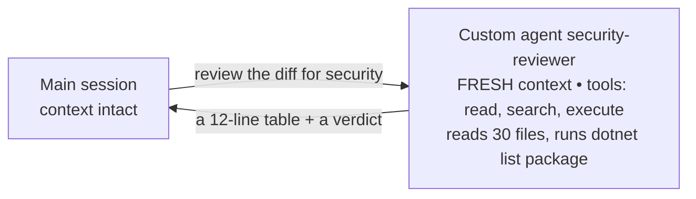
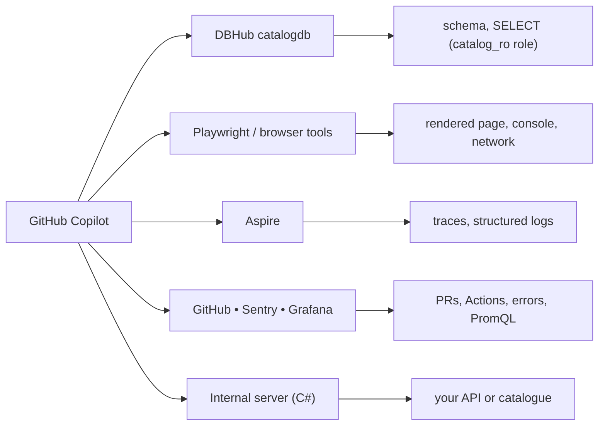
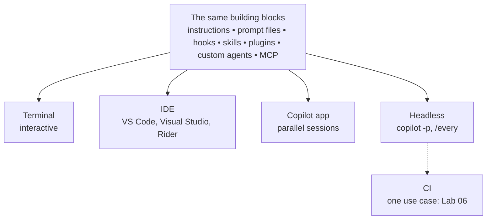
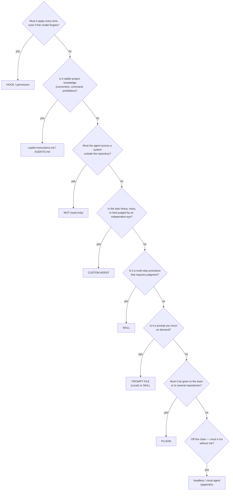

# The GitHub Copilot Building Blocks

**From the throwaway prompt to a versioned team toolkit**

Instructions • prompt files • agent skills • hooks • plugins • custom agents • MCP

Bassem Ben Hamed • ODDO BHF • October 15, 2026

> **Copilot edition.** This is the English, GitHub Copilot–oriented counterpart of `02-claude-code-briques.md`. It keeps the same learning path and use cases, but maps every building block to its Copilot form: repository instructions, prompt files, agent skills, hooks, plugins, custom agents, MCP, and the cloud/headless execution surfaces.
>
> **One important rule.** Copilot runs in several surfaces — VS Code, Visual Studio, JetBrains, Copilot CLI, the Copilot app, and the GitHub cloud agent. They share many files, but not every feature is available in every surface. Each module states the boundary explicitly.

## How to read this edition

| Concept in the original | Copilot equivalent used here |
| --- | --- |
| `CLAUDE.md` | `.github/copilot-instructions.md` or `AGENTS.md` |
| `.claude/commands/*.md` | `.github/prompts/*.prompt.md` (Local harness) or a skill |
| `.claude/settings.json` hooks | `.github/hooks/*.json` |
| `.claude/skills/<name>/SKILL.md` | `.github/skills/<name>/SKILL.md` |
| `.claude/agents/*.md` | `.github/agents/*.agent.md` |
| `.claude-plugin/` plugins | `plugin.json` + `com.github.copilot/` |
| `@agent-security-reviewer` | custom agent selected in the picker, or delegated by description |
| `claude -p` | `copilot -p` |
| `@claude` in a PR | Copilot code review or the Copilot cloud agent |

## The through-line



| # | Building block | The limit it removes |
| --- | --- | --- |
| 00 | **Getting started** | “What does it see, what can it do, what will it do without asking?” |
| 01 | **Native commands** | “I cannot stop it, undo it, or see what it is thinking.” |
| 02 | **Context & memory** | “It ignores our conventions in every session.” |
| 03 | **Prompt files** | “I retype the same review prompt every day.” |
| 04 | **Hooks** | “My instructions say not to commit secrets; nothing enforces it.” |
| 05 | **Agent skills** | “A hook can say no, but it cannot carry out a procedure.” |
| 06 | **Plugins** | “Twelve colleagues, eight repositories — and I keep rebuilding what already exists.” |
| 07 | **Custom agents** | “The review floods my session and rubber-stamps its own code.” |
| 08 | **MCP** | “It can see neither the database, nor the browser, nor the traces.” |
| A | **Appendix** | The agent without a terminal: an execution mode for the same building blocks, not another building block |

---

# 00 — Getting started

## The limit — getting started

> “What does it see, what can it do, what will it do without asking?”

### Dev use case

“Explain how Ordering validates a product.”

Will it **read the code**, or invent a plausible answer?

### DevOps use case

“Run the build.”

Will it **execute a command** on my machine? With which rights?

### The building block that removes this limit

Understand the **agent** — a model, tools, a loop — and the **permission box**, your last line of defence. Until those three points are clear, do not start it on a repository that matters.

## Install, verify, launch

```bash
# VS Code: install GitHub Copilot and GitHub Copilot Chat, then sign in
code --install-extension GitHub.copilot
code --install-extension GitHub.copilot-chat

# Copilot CLI (Node.js 22 or later)
npm install -g @github/copilot
copilot --version
copilot                  # interactive session

cd ~/lab-ecommerce       # THE FOLDER determines what the agent sees
copilot                  # start here
```

On Windows, Copilot CLI can also be installed with WinGet. On macOS and Linux, Homebrew and the install script are available. The important part is not the installer: it is the working directory.

### At startup, in order

1. The **working directory** becomes the default boundary.
2. **Instructions** are loaded: `.github/copilot-instructions.md`, `AGENTS.md`, and matching `.github/instructions/*.instructions.md` files.
3. **Tools, hooks, skills, plugins, custom agents, and MCP servers** are loaded according to the selected surface.
4. The agent waits for your prompt.

### The key moment

When it asks to run a command, **read the dialogue** instead of approving it reflexively. That is your last line of defence — until module 04 replaces approval with a control.

## Three channels, three surfaces

| You type | It goes to | Example |
| --- | --- | --- |
| Free text | The **model**, which interprets it | “What happens if I order a nonexistent product?” |
| `/command` | The **harness**, which executes it | `/context`, `/plan`, `/undo`, `/permissions` |
| `!command` | The **shell**; the output enters the context | `!dotnet build ECommerce.slnx` |
| `@file` in Copilot CLI | The **context** | `@src/ECommerce.Ordering.Api/Program.cs` |
| `#file` in VS Code | The **context** | `#file:src/ECommerce.Ordering.Api/Program.cs` |
| `#123` in Copilot CLI | A GitHub issue or pull request | `#42` |
| A note for later | **Instructions**, not a magic prefix | Edit `.github/copilot-instructions.md` |

> **Copilot nuance.** There is no universal `#note` shortcut that silently writes to repository memory. In VS Code, add the rule through the Agent Customizations editor or edit the instructions file. In Copilot CLI, edit `.github/copilot-instructions.md`, `AGENTS.md`, or your personal `~/.copilot/copilot-instructions.md`. This is better: a memory change is a reviewable change.

| Surface | When to prefer it |
| --- | --- |
| **Copilot CLI (`copilot`)** | The reference for this course; essential for headless use and CI |
| **VS Code, Visual Studio, JetBrains** | Diffs in the editor, selection as context, IDE diagnostics |
| **Copilot app** | Several sessions in parallel, visual review |
| **GitHub cloud agent** | Asynchronous work on an issue or pull request, without your machine |

All surfaces read the **same** repository files: instructions, skills, agents, hooks, and MCP configuration. **What must work every time goes through the harness** — permissions and hooks — not through a prompt.

---

# 01 — Native commands

## The limit — native commands

> “I cannot stop it, undo it, or see what it is thinking.”

### Dev use case

“Add pagination to the catalogue.” It touches the endpoint, the web client, the Blazor page… The refactoring drifts: how do you return **exactly** to the previous state?

### DevOps use case

It wants to change `docker-compose.yml` or `appsettings.json`: how do you **read what it is about to do** before authorizing it?

### The building block that removes this limit

**Native commands**: executed by the **harness**, not interpreted by the model. `/plan` to see before acting, `/undo` or `/rewind` to go back, `/context` to see what it is holding.

## The harness, not the model



### Frame the work

| Command | Effect |
| --- | --- |
| `/init` | Generates repository instructions: the first gesture |
| `/plan` or Plan mode | Explores, proposes, waits for **your approval** |
| `/goal` | Sets the autopilot objective; flags drift |
| `/model` | Chooses the model; use the strongest one before a migration review |

In VS Code, use the **Plan** agent or the plan mode in the agent picker. In Copilot CLI, `/plan` and the mode selector provide the same discipline: inspect before editing.

### Take back control

| Command | Effect |
| --- | --- |
| `/undo` | Reverts the last turn’s changes |
| `/rewind` | Returns to a **checkpoint**: code, conversation, or both |
| `/btw` (alias `/ask`) | Adds a precision **without interrupting** the current task |
| `/compact` | Summarizes to free context |
| `/clear` | Starts empty; instructions remain loaded |

`/undo` and `/rewind` have a limit: they restore files edited by the agent, **not** the effects of a shell command (an applied migration, a built image, a deleted volume). For those: Git, the platform, and the guardrails. The distinction is the whole point of module 04.

### See and verify

- `/context` — what occupies the window, source by source: the number-one diagnostic.
- `/usage` or the usage view — cost and limits, where your plan exposes them.
- `/tasks` — what runs in the background, including subagents.
- `/env` — what is actually loaded: instructions, skills, hooks, MCP servers, plugins. This is the proof, not the documentation.

### The commands that open the rest of the course

- `/instructions` — module 02 — context and memory (Copilot CLI; VS Code exposes the same files in the Agent Customizations editor)
- `/prompts` or the Agent Customizations editor — module 03 — prompt files (**VS Code only**)
- `/hooks` — module 04 — hooks (**VS Code only**)
- `/skills` — module 05 — skills
- `/plugin` — module 06 — plugins
- `/agent` — module 07 — custom agents
- `/mcp` — module 08 — MCP
- `/delegate` — appendix — hand off to the cloud agent

> **Surface check.** `/prompts` and `/hooks` are VS Code surfaces, not Copilot CLI commands. In Copilot CLI, use `/env` to confirm which instructions, skills, hooks, MCP servers, and plugins are loaded.

### Quality and security

- `/plan` before a multi-file change, then review the diff.
- Copilot code review on the pull request: bugs, missing tests, security smells.
- A custom `security-reviewer` agent before each sensitive PR (module 07).
- `/permissions` — allow, ask, deny — **before** you let it run alone.

### One source of truth

Type `/` in a session: the list depends on your version and surface. The commands above are the stable core; the UI around them changes faster than the files this course teaches.

---

# 02 — Context & memory

## The limit — context & memory

> “Every session starts from zero: it ignores our conventions.”

### Dev use case

It writes `new Uri("http://localhost:5147")` instead of the service-discovery name `https+http://catalog`. It logs `order.Customer`: personal data in telemetry, and a GDPR problem.

### DevOps use case

It runs `dotnet build` at the root instead of `dotnet build ECommerce.slnx`: projects are skipped and the CI behaves differently from the workstation. It creates `feature-pagination` instead of a `feat/` branch.

### The building block that removes this limit

Repository instructions: a **versioned memory**, read in **every** session, by **the whole team**. It did not forget your conventions: it **never knew them**.

## Three horizons of memory



### More than one instruction file

`.github/instructions/blazor.instructions.md` with `applyTo: 'src/ECommerce.Web/**/*.razor'` is loaded only when the agent works on those files: Blazor and accessibility conventions. You can reference another file with `@docs/conventions-api.md` inside `.github/copilot-instructions.md` or `AGENTS.md`.

### The nuance that prepares module 04

Instructions **inform**; they do **not enforce**. The model reads them and can depart from them. That is not a defect to fix with a stronger adjective; it is a reason to add a control in module 04.

## A useful `.github/copilot-instructions.md`

```markdown
# ecommerce-app

## Stack
.NET 10 / ASP.NET Core, orchestrated by .NET Aspire.
Catalog.Api and Ordering.Api (minimal APIs + EF Core),
Gateway (YARP), Web (Blazor Server).

## Commands
dotnet build ECommerce.slnx      # always the solution
dotnet test ECommerce.slnx
dotnet run --project src/ECommerce.AppHost

## Conventions
- Services are called by name (https+http://catalog):
  NEVER a hard-coded URL.
- Branches feat/, fix/, chore/; Conventional Commits.

## Prohibitions
- No customer data in a log or a trace.
- No secret in appsettings.json: use user-secrets.
- Never modify a test just to make a build pass.
- Never modify an already committed migration.
```

| Useful | Useless |
| --- | --- |
| “`dotnet build ECommerce.slnx`” | “Best practices” |
| “Never a hard-coded URL” | “Clean code” |
| “No customer name in logs” | “Pay attention to security” |

### The test

If you cannot say **objectively** whether the rule was followed, it does not belong in the file.

### The size

**40 to 120 lines**: every line is paid for in every session. A 400-line file is not a memory; it is a context leak.

## Path-specific instructions, and managing the window

```markdown
---
name: 'Blazor and accessibility'
description: 'Use when changing the Blazor web client.'
applyTo: 'src/ECommerce.Web/**/*.razor'
---
- Every interactive component has a keyboard path and a visible focus state.
- Never put a connection string or a customer field in the rendered page.
- Reuse the components in `Components/Shared`; do not create a third button.
```

| Situation | Command |
| --- | --- |
| The context fills up, the task continues | `/compact`: keep the list of modified files |
| New topic | `/clear`, or a new chat in VS Code; instructions stay loaded |
| Understand what occupies the space | `/context` |
| See or disable an instruction file | `/instructions` in Copilot CLI; Agent Customizations editor in VS Code |

> **Key takeaway**
>
> The most profitable capitalization gesture in this course is turning a correction into an instruction. A correction made once is written for the whole team — and reviewed like code.

---

# 03 — Prompt files

## The limit — prompt files

> “It knows the rules — but I retype the same twenty-line prompt.”

### Dev use case

“Review the diff: API contracts, tests, secrets, migrations, hard-coded URLs. Return a table.” Before every PR, everyone has their own variant.

### DevOps use case

“Prepare the delivery: tests, conventional commit, documented PR. Wait for my approval.” Several times a day, never in the same order.

### The building block that removes this limit

The **prompt file**: a Markdown file whose content is sent as a prompt, invoked as a slash command. Instructions say what the agent must **know**; a prompt file says what it must **do** when you ask.

> **Copilot nuance.** Prompt files are a **VS Code Local-harness** feature. They run in the Chat view when **Local** is selected; they do not run in the Copilot CLI or the cloud agent. For those surfaces, create the same workflow as an **agent skill** (module 05). The body can be identical; the packaging is what changes.

## A prompt that becomes a file



```markdown
---
name: review-diff
description: Reviews the current diff against the team checklist without changing files
argument-hint: [focus area]
agent: agent
tools: ['read', 'search', 'execute']
---
Review the current branch diff. Start by running:
`git diff --stat main...HEAD` and `git diff main...HEAD`.
For each modified file:
1. Correctness — does the code do what the commits announce?
2. Contracts   — did a route, DTO, or JSON field change? Who consumes it?
3. Tests       — does every modified behavior have a test?
4. Conventions — hard-coded URL? secret? customer data in a log?
5. Database    — is there a migration? Is it destructive?
Return a table File | Finding | Severity | Proposal, then a verdict.
Read-only. Do not edit files. Requested focus: ${input:focus}
```

| Element | Role | Example |
| --- | --- | --- |
| `${input:focus}` | asks for additional input | `/review-diff security` |
| `#file:` or Markdown links | attaches supporting files | `#file:docs/review-checklist.md` |
| `tools` | pre-authorized tools for this prompt | `['read', 'search', 'execute']` |
| `agent` | `ask`, `agent`, `plan`, or a custom agent | `agent` |

### What a prompt file does not do

It does not run by itself. It does not enforce anything. It does not fire on an event. It is a **shortcut you trigger**, with the body you would otherwise retype.

## Where to place them — and the three lab prompts

### Scope

| Location | Scope |
| --- | --- |
| `.github/prompts/` | The project, the whole team; VS Code Local harness |
| Your VS Code profile, via the Agent Customizations editor | You, everywhere |

The command name comes from `name` (or from the file name when `name` is omitted). Do not rely on a subfolder to create a namespace such as `/db:explain`. If you need namespacing, cross-surface reuse, or team distribution, package a **plugin command** or a **skill** instead.

Prompt files are not a plugin distribution format: a plugin ships commands and skills through its own manifest, not as `.prompt.md` files.

### The three prompts of Lab 01

`/review-diff` • `/ship` (diff, tests, commit, PR) • `/init-repo`

A prompt file for `/ship` can instruct the agent to run the tests, propose a Conventional Commit, and open a PR, but it must **wait for approval** before pushing. The prompt is the recipe; permissions and hooks are the boundary.

### Instructions vs prompt file

|  | Instructions | Prompt file |
| --- | --- | --- |
| **Content** | What it must know | What it must do |
| **Loaded** | Always | On invocation |
| **Cost** | Permanent | Zero outside invocation |
| **Surface** | VS Code, CLI, cloud agent | VS Code Local harness only |

### Good to know

Prompt files are in preview and evolve quickly. In VS Code, `/create-prompt` can generate one; the Agent Customizations editor can create, run, and inspect them. For Copilot CLI and the cloud agent, use a skill: it is the cross-surface equivalent of a reusable command.

> **Key takeaway**
>
> A prompt file is an **instruction you trigger**. It does nothing when nobody calls it — which is exactly the limit Lab 01 will reveal.

---

# 04 — Hooks

## The limit — hooks

> “My instructions say ‘do not commit secrets’; nothing prevents it.”

### Dev use case

A password slipped into `appsettings.Development.json` goes into a commit — a colleague committed without going through `/ship`. Formatting only happens if someone remembers to run it.

### DevOps use case

A `docker compose down -v` wipes a colleague’s local database during a demo. And nobody “remembers” to log every command: DORA traceability is missing.

### The building block that removes this limit

The **hook**: a script launched by the **harness** on an event. The model can neither bypass it, nor forget it, nor decide it is “not useful this time.” We move from an **instruction** to a **control**.

## Instruction or control: the distinction that decides everything



|  | Prompt file (03) | Instructions (02) | Hook |
| --- | --- | --- | --- |
| **Who decides to apply it** | You, by typing `/name` | The model | The harness, on an event |
| **Applies if it is forgotten** | No | Not necessarily | Yes |
| **Can block an action** | No | No | Yes |
| **Can execute code** | No | No | Yes |

**Permission or hook?** A pattern is enough (`deny shell(git push --force)`) → permission. You need to inspect the context → hook.

## Events — and their Dev & DevOps use

| Event | Blocks? | Dev use | DevOps use |
| --- | --- | --- | --- |
| **preToolUse** | Yes | Refuse a commit containing a secret; forbid editing a committed migration | Refuse `kubectl delete ns`, `compose down -v` |
| **postToolUse** | No | Format the `.cs` file just written | Audit log; image scan after `docker build` |
| **agentStop** | Yes | Refuse to finish while tests are red | Refuse to finish when `helm lint` fails |
| **sessionStart** | No | Remind the branch, warn on `main` | Remind the current `kubectl` context |
| **subagentStop** | Yes (for the subagent) | Check a reviewer returned the required format | Check a diagnostic agent cited evidence |
| **userPromptSubmitted** | No (observation) | Log prompts for audit | Detect a pasted key and alert |

> **Copilot nuance.** `userPromptSubmitted` is an observation event: command-hook output is ignored, so it cannot block a prompt. Use it to detect and alert, not as a hard preventer. The hard control for a pasted secret is a pre-commit secret scanner, a `preToolUse` check on the write/commit tool, and secret scanning on the platform.

### The contract

**Input:** the event as JSON on stdin (`toolName`, `toolArgs`, and event-specific fields). **Output:** a JSON decision on stdout. For `preToolUse`, return:

```json
{
  "permissionDecision": "deny",
  "permissionDecisionReason": "This operation is irreversible. Present the impact and a reversible alternative; a human must run it."
}
```

Return `{}` for no decision. An `ask` decision requires an interactive approval flow; do not assume it pauses an unattended session. For command hooks, a non-zero exit is treated as an error; a `preToolUse` error denies the call, while a timeout falls through to the normal permission flow. Test the exact behavior of your version; do not assume every failure blocks work.

> **Important for hook authors.** Exit code `2` is not the only blocking mechanism here. Use the documented JSON decision. A hook that writes a human-readable message to stdout without valid JSON may be ignored or treated as an error. Keep diagnostics on stderr and the decision on stdout.

## A complete guard hook

```bash
#!/usr/bin/env bash
# .github/hooks/guard-destructive.sh
# preToolUse hook -- blocks irreversible commands.
set -uo pipefail

payload="$(cat)"
tool="$(jq -r '.toolName // .tool_name // empty' <<<"$payload")"
cmd="$(jq -r '
  (.toolArgs.command? // .toolArgs.cmd? // .tool_input.command? // empty)
  | if type == "string" then . else empty end
' <<<"$payload")"

# Only shell tools carry a command in this hook.
case "$tool" in
  bash|powershell|shell) ;;
  *) echo '{}'; exit 0 ;;
esac

[ -z "$cmd" ] && { echo '{}'; exit 0; }

DB='DROP (TABLE|DATABASE|SCHEMA)|dotnet ef database drop'
DOCKER='docker (volume rm|system prune)|docker compose down .*(-v|--volumes)'
INFRA='kubectl delete (ns|namespace|pvc)|k3d cluster delete|helm uninstall'
GIT='git push .*(-f|--force)|git reset --hard|git clean -[a-z]*f'

if printf '%s' "$cmd" | grep -qiE "$DB|$DOCKER|$INFRA|$GIT"; then
  jq -n --arg cmd "$cmd" '{
    permissionDecision: "deny",
    permissionDecisionReason: ("Blocked by guard-destructive: " + $cmd + ". Present the impact and a reversible alternative; a human must run it.")
  }'
  exit 0
fi

echo '{}'
exit 0
```

**Why `jq`:** a `grep` on raw JSON misses an escaped or multi-line command. A guardrail that misses one time in twenty is not a guardrail. The script needs `jq` and bash; on Windows, run it through Git Bash or WSL. The cloud agent runs it in a Linux sandbox.

**Test it like a script:**

```bash
echo '{"toolName":"bash","toolArgs":{"command":"git push --force"}}' \
  | .github/hooks/guard-destructive.sh | jq .
# => { "permissionDecision": "deny", "permissionDecisionReason": "..." }

echo '{"toolName":"bash","toolArgs":{"command":"git status"}}' \
  | .github/hooks/guard-destructive.sh | jq .
# => {}
```

## Wiring — and the only proof a hook is active

```json
{
  "version": 1,
  "hooks": {
    "preToolUse": [
      {
        "type": "command",
        "command": ".github/hooks/guard-destructive.sh",
        "timeoutSec": 30
      }
    ],
    "postToolUse": [
      {
        "type": "command",
        "command": ".github/hooks/format-cs.sh",
        "timeoutSec": 60
      }
    ]
  }
}
```

Save it as `.github/hooks/guard.json`. Command paths resolve from the repository root; in a plugin, use `${PLUGIN_ROOT}`. The `preToolUse` hook receives camelCase fields; a `PreToolUse` alias receives snake_case fields. Pick one convention and test it. In the Local harness, matcher values are ignored and the script itself filters `toolName`; that is why the script checks the tool before inspecting the command.

### The three hooks of the mini-lab

- `guard-destructive` — **block**
- `secret-scan` — **block based on context** (gitleaks on the staged diff)
- `format-cs` — **correct after the fact** (`dotnet format`, *relative* path)

### `/hooks` is the only proof

A badly wired hook (non-executable script, wrong event name, wrong path, or a case mismatch such as `Bash` where the payload says `bash`) produces **no error**: it simply never fires. In VS Code, open `/hooks` and confirm the config and script are discovered. In Copilot CLI, `/env` shows what is loaded. A file in the repository is not proof.

---
# 05 — Agent skills

## The limit — agent skills

> “A hook can say **no** or format a file. It cannot **carry out** a procedure.”

### Dev use case

“Add a unique SKU to products.” Model, `OnModelCreating`, `migrations add`, **reviewing the SQL**, seed, Testcontainers tests: eight steps, a checklist, known traps.

### DevOps use case

“Containerise Gateway.” Multi-stage build, non-root, `.dockerignore`, UID verification, scan — with its own traps (a chiselled image without an ID, the build context).

### The building block that removes this limit

The **skill**: a **folder** with a procedure and its supporting files, which the agent **mobilises by itself** when your request matches its description. An executable runbook.

## Prompt file, skill, hook: the boundary

|  | Prompt file (03) | Skill | Hook (04) |
| --- | --- | --- | --- |
| **Who triggers it** | You (`/name`) | **The agent**, based on the description — and you | The harness, on an event |
| **Shape** | One file | **A folder**: procedure + supporting files + scripts | A script |
| **Context cost** | The whole prompt, on invocation | **The description alone** is always loaded | None |
| **Nature** | A shortcut | **Know-how with judgment** | A guarantee without judgment |
| **Analogy** | A shell alias | **A runbook** | A firewall rule |

### Progressive disclosure

| Level | What is loaded |
| --- | --- |
| always in context | `name` + `description` (roughly 80 tokens) |
| on use | the body of `SKILL.md` |
| when the procedure says so | `checklist-review.md`, `doctrine.md` |
| executed, never read | `scripts/*.sh` |

### The mental switch

The description is not documentation: it is the **trigger criterion**. Vague = never triggered. Write it with the words your users actually use.

## Anatomy: the ef-migration skill

```text
.github/skills/ef-migration/
|-- SKILL.md               <- frontmatter (the trigger) + the procedure
\-- checklist-review.md    <- supporting file, read ONLY when the procedure needs it
```

```markdown
---
name: ef-migration
description: Evolves the ecommerce-app PostgreSQL schema with EF Core -- modify
  the entities and the DbContext, generate the migration with dotnet ef, review the
  produced SQL, apply it locally, and verify it in the database. Use when adding a
  table, a column, an index, a constraint, or seed data. Never applies a migration
  outside the local machine and never rewrites an already committed migration.
---
## Procedure
1. Model     -- entities and OnModelCreating: lengths, indexes, CHECK, Restrict by default.
2. Compile.
3. Generate  -- dotnet ef migrations add <ExplicitName>.
4. Review the SQL, not the C# -- dotnet ef migrations script; walk checklist-review.md.
5. Apply locally, verify in the database, run the tests.
## Guardrails
- A committed migration is immutable: add a new one.
- Any destructive operation is reported at the top of the response.
```

**The test that matters:** describe the situation **without naming the skill**. If it does not trigger, rewrite the description.

## Control who triggers it — and the four rules

| Frontmatter | Who can trigger it | Example |
| --- | --- | --- |
| *(default)* | The agent and you | `gen-tests`, `ef-migration` |
| `disable-model-invocation: true` | **You only** | `init-repo`, `deploy`: a side effect the agent must not decide |
| `user-invocable: false` | **The agent only** | `conventions-api`: background knowledge, not an action |

### The four rules of a good skill

1. A **description that says *when***, using the users’ words.
2. **Ordered, verifiable steps**.
3. A **Guardrails** section: what it must never do.
4. An **imposed output format**.

### Useful fields

`argument-hint` • `context: fork` (runs in a dedicated subagent context; requires the forked-skill setting in VS Code) • `user-invocable` • `disable-model-invocation`

The `name` must be lowercase, use hyphens, match its directory, and stay under 64 characters. The `description` is what the model reads to decide whether to load the skill; keep it specific and under 1,024 characters.

### Do not confuse

A rule that **must** hold = a hook. A skill is not guaranteed.

> **Copilot nuance.** Skills are the portable, cross-surface version of a reusable procedure: VS Code, Copilot CLI, the Copilot app, and the cloud agent all discover `.github/skills/`. Prompt files are Local-only. When a workflow must work everywhere, package it as a skill.

---

# 06 — Plugins

## The limit — plugins

> “Everything lives in **my** `.github/`. Twelve colleagues, eight repositories — and I may be reinventing what already exists.”

### Dev use case

The `agentStop` hook reveals a type error after a full `dotnet test`. A **C# language server** would show it right after each edit — and someone else maintains it.

### DevOps use case

The guardrails (secret scan, destructive-command block, audit) must be **identical** everywhere and up to date. And you were about to write a Grafana connector that the editor already publishes.

### The building block that removes this limit

The **plugin**: a versioned package (skills, agents, hooks, MCP, commands, automation templates), distributed through a **marketplace**. The principle: **consume before you produce**, then distribute and govern.

## The package and the catalogue



|  | The project’s `.github/` | A plugin |
| --- | --- | --- |
| **Scope** | One repository | Every repository where it is enabled |
| **Distribution** | Copy-paste | `copilot plugin install`, one command |
| **Update** | Everyone redoes the copy | One commit + a version bump |
| **Names** | `/ship` | `/oddo-dev-toolkit:ship` — no collision |
| **Content** | instructions, prompt files, skills, agents, hooks, MCP | + automation templates, LSP definitions in legacy plugins, packaged scripts |

## Consuming: the Dev & DevOps selection

| Need | Where to look | What it brings |
| --- | --- | --- |
| Compiler diagnostics | C# Dev Kit / Roslyn language server; `csharp-lsp` plugin where available | Errors **after each edit** |
| Up-to-date documentation | Context7 MCP server or plugin | The docs for the exact version |
| Git workflow | A team prompt/skill or a marketplace commit plugin | `/commit`, `/commit-push-pr`, PR preparation |
| Review | Copilot code review + review agents | Bugs, tests, security smells |
| Security | GitHub code scanning, secret scanning, a `security-reviewer` agent | **Hooks** and diff review |
| Front end | `frontend-design` skill, Playwright MCP | Visual direction; E2E |
| Forges & run | GitHub MCP, Sentry, Grafana MCP | PRs, errors, metrics |
| Tooling | skill/agent/hook creators in `awesome-copilot`; the plugin authoring reference | A skill, an agent, a hook |

*Marketplace contents change. Treat this table as a map of categories, not a fixed catalogue.*

### `/plugin` — read before installing

Review the publisher, the included components, the tools and hooks it will run, and the network destinations. Then install it in a test workspace and measure what loads every session with `/context`. A plugin is code that runs with your rights.

### The demo that convinces

With a C# language server, the agent sees CS0266 **without running a build**. That is the difference between a hook that reports a problem late and a tool that prevents it early.

## Read a plugin before installing — three common shapes

### A skills-only plugin — the procedure is the product

```text
my-skills/
  plugin.json
  skills/
    ef-migration/
      SKILL.md
      checklist-review.md
```

The manifest is almost empty; the value is in the skill. Read the procedure and its guardrails before installing.

### An MCP-only plugin — a connection, packaged

```json
{
  "mcpServers": {
    "context7": {
      "type": "http",
      "url": "https://mcp.context7.com/mcp"
    }
  }
}
```

The plugin is a distribution wrapper around a server. The cost is not zero: every response from the server enters the context.

### A Copilot-specific plugin — agents and hooks

```json
{
  "$schema": "https://agent-plugins.org/schemas/1.0.0/plugin.schema.json",
  "name": "oddo-dev-toolkit",
  "description": "ODDO BHF Dev & DevOps conventions, review agents, and guardrails",
  "version": "1.0.0"
}
```

```text
oddo-dev-toolkit/
  plugin.json
  skills/
    ef-migration/SKILL.md
    gen-tests/SKILL.md
  mcp.json
  com.github.copilot/
    agents/security-reviewer.agent.md
    hooks/hooks.json
```

The portable parts (`skills/`, `mcp.json`) work across compatible clients. The Copilot-specific parts live under `com.github.copilot/` and are ignored by other clients.

### A remote MCP server that needs a secret

```json
{
  "mcpServers": {
    "grafana": {
      "type": "http",
      "url": "https://grafana.example.com/mcp",
      "headers": {
        "Authorization": "Bearer ${GRAFANA_TOKEN}"
      }
    }
  }
}
```

The token is a **reference**, not a value. It comes from the environment or the operating system’s secret store, never from a committed file. If a plugin asks for a credential at activation, check where it stores it before typing it.

### The reading grid, in a bank

1. **Publisher?** 2. **Components**: hooks and MCP run with **your** rights, often without context cost — and therefore without noise. 3. **Network**: a remote MCP receives what the agent sends it (R1, R6). 4. **Cost** *every turn*. 5. **Version** pinned?

## Producing: the team plugin

```text
oddo-dev-toolkit/
|-- plugin.json                 <- Agent Plugins 1.0 manifest
|-- skills/<name>/SKILL.md (+ supporting files)
|-- mcp.json                    <- portable MCP servers
\-- com.github.copilot/
    |-- agents/<name>.agent.md
    |-- commands/               <- optional slash commands
    \-- hooks/hooks.json + *.sh
```

| In the project’s `.github/` | In a plugin |
| --- | --- |
| Relative path from the repository root | `${PLUGIN_ROOT}` for packaged files |
| `.github/copilot-instructions.md` | A plugin does not read the repository file; put always-on guidance in a skill, or in `com.github.copilot/rules/` where the client supports it |
| `/ship` | `/oddo-dev-toolkit:ship` |
| MCP servers in the repo | `mcp.json` |
| Hooks in `.github/hooks/` | `com.github.copilot/hooks/hooks.json` |

```bash
P=plugins/oddo-dev-toolkit
copilot plugin install "$P"
copilot plugin list
```

Then start a session and confirm the components:

```text
Skills (10)  ef-migration, gen-tests, ...
Agents (6)   security-reviewer, ...
Hooks (3)    harness-only, 0 context tokens
Always-on    instruction + skill descriptions: measure with /context
```

### What the real output tells you

Skills and commands cost their **descriptions** in every session; hooks cost **nothing in context**, which does not mean nothing in risk. Measure the always-on part instead of trusting a marketing figure.

### The classic trap

Keeping hooks in `.github/hooks/guard.json` **and** in the plugin: they run **twice**. `/hooks` or `/env` shows the duplicate.

## Distributing: the internal marketplace and the standard workstation

```json
{
  "name": "oddo-dev-marketplace",
  "owner": {
    "name": "ODDO BHF",
    "email": "plugins@example.com"
  },
  "metadata": {
    "description": "Curated Dev & DevOps plugins for the bank",
    "version": "1.0.0"
  },
  "plugins": [
    {
      "name": "oddo-dev-toolkit",
      "source": "./plugins/oddo-dev-toolkit",
      "version": "1.0.0"
    },
    {
      "name": "oddo-dev-standard",
      "source": "./plugins/oddo-dev-standard",
      "version": "1.0.0"
    }
  ]
}
```

Save it as `.github/plugin/marketplace.json`. Then a repository can register the marketplace and enable its defaults:

```json
{
  "extraKnownMarketplaces": {
    "oddo-dev-marketplace": {
      "source": {
        "source": "github",
        "repo": "ODDO-BHF/copilot-dev-toolkit"
      }
    }
  },
  "enabledPlugins": {
    "oddo-dev-toolkit@oddo-dev-marketplace": true,
    "csharp-lsp@oddo-dev-marketplace": true,
    "context7@oddo-dev-marketplace": true
  }
}
```

*Replace the last two entries with the plugins your marketplace actually publishes. The point is the pattern: the marketplace key must match `name`, and plugin identifiers use `<plugin>@<marketplace>`.*

### A “bundle” plugin — the Copilot version

Agent Plugins 1.0 does not define cross-plugin dependencies. A bundle is therefore either:

- a plugin that packages the shared **skills + MCP** and leaves the rest to repository settings; or
- a set of plugins enabled together in `.github/copilot/settings.json`.

One command to install, several components enabled. A fix is one commit and a version bump; on the workstation, `copilot plugin update <name>` and a new session.

## Governing: what IT can impose

### Three ways to distribute

| Method | Detail |
| --- | --- |
| **Manual** | `copilot plugin install` — for trying it |
| **Per repository** | `extraKnownMarketplaces` + `enabledPlugins` in `.github/copilot/settings.json` — **one team** |
| **By IT** | The same controls in enterprise-managed settings — the whole organisation, not locally overridable |

### Managed settings — they win over every scope

| Setting | Effect |
| --- | --- |
| `ChatPluginsEnabled` | Enable or disable agent plugins entirely |
| `ChatEnabledPlugins` | Force-enable or force-disable named plugins |
| `ChatExtraMarketplaces` | Add approved marketplaces |
| `ChatStrictMarketplaces` | Restrict installation to approved sources; an empty list blocks all |
| `ChatAllowManagedHooksOnly` | Only managed hooks run |
| `ChatStrictPluginOnlyCustomization` | Skills, agents, instructions, and MCP **only** through plugins |
| `ChatCopilotConnectors` | Controls connector discovery and connected MCP servers |

### What validation does not do

It checks the **shape** of the manifest, not the **intentions** of its author. A valid plugin can still run a hostile hook.

> **Key takeaway**
>
> In a bank, the list of approved sources is not an individual choice: a plugin **executes code** on the workstation.

---

# 07 — Custom agents

## The limit — custom agents

> “The review floods my session — and the reviewer rubber-stamps its own code.”

### Dev use case

A security review of the whole repository reads thirty files and runs `dotnet list package`: 60% of the context before the first fix. And the reviewer **wrote** the code: it knows the intentions.

### DevOps use case

A pod in CrashLoopBackOff: 800 lines of logs and events. You want the **15 useful lines**, not the 800 in the session — and a diagnosis that cannot change anything.

### The building block that removes this limit

The **custom agent** (used as a subagent): an executor with **its own** instructions, **its own** tools, and **its own** context window. It works on the side and returns only its conclusion.

## Delegating with a separate context



### Four benefits, in order

1. **Context isolation**: the noise stays with the subagent.
2. **Independence of judgment**: it judges the code, not the intention.
3. **Tool restriction**: without `edit`, it cannot modify files directly.
4. **Parallelism**: several axes at the same time.

|  | Skill | Custom agent |
| --- | --- | --- |
| **Nature** | A playbook | An executor |
| **Context** | Yours | **Its own, fresh** |
| **Tools** | Yours | **Those granted to it** |
| **Returns** | The whole walkthrough | **A synthesis** |

## Anatomy: security-reviewer

```yaml
---
name: security-reviewer
description: Reviews a diff or part of the ecommerce-app for security and banking-compliance issues — secrets, injection, authorization, personal data in logs, vulnerable dependencies. Use before a PR. Read-only.
tools: ['read', 'search', 'execute']   # no edit
---
You are an application security engineer in a bank subject to DORA and GDPR.
You did not see the conversation that produced this code: that is intentional.
Your role is to doubt.

## Method
1. Scope: `git diff main...HEAD --stat`.
2. Secrets, PII in logs, injection, exposure,
   `dotnet list package --vulnerable`, configuration.
## Output format
| Severity | File:line | Finding | Fix |
```

> **Read-only is a policy, not a tool name.** `execute` grants a shell. Omitting `edit` prevents direct file edits, but not `Set-Content`, `rm`, or a migration command. Add a permission or hook that denies writes, or give the reviewer no `execute` and accept that it cannot run `dotnet list package`. This is the honest trade-off.

| Field | Role |
| --- | --- |
| `description` | **When** to delegate |
| `tools` | Minimal allowlist |
| `model` | A cheaper model for filtering tests; a stronger one for security |
| `skills` | Skills preloaded into the agent |
| `mcp-servers` | Editor schema; **not reliably forwarded** — see the caveat below |
| `user-invocable` / `disable-model-invocation` | Picker visibility vs automatic delegation |
| `hooks` | Agent-scoped guardrails |
| `agents` | Subagent allowlist in the Local harness |

> **Copilot nuance.** `mcp-servers` is recognized by the editor schema, but VS Code does not forward it when converting agent files to the SDK, including plugin-provided agents. Do not rely on agent-scoped MCP as a hard boundary. Configure the server at repository level, make it read-only at the system level, and give the agent only the server’s tools (`catalogdb/*`).

### Invoking it

Implicitly, through the description when another agent delegates • explicitly, from the **Agent** dropdown in VS Code • `/agent` in Copilot CLI to choose or create one • `/fleet` in Copilot CLI for parallel subagents. Other surfaces may run delegated agents sequentially.

## The six custom agents of the team plugin

| Agent | Role | Writes? | Lab |
| --- | --- | --- | --- |
| `security-reviewer` | Secrets, injection, PII in logs, dependencies | No | 03, PR review |
| `test-engineer` | “What is not tested?”, ranked by risk | No | 02 |
| `db-reviewer` | EF Core migration checked against the real database (MCP) | No | 04 |
| `a11y-reviewer` | Accessibility of the rendered page (browser tools) | No | 05 |
| `k8s-debug-pod` | Failing pod: events, `logs --previous`, cause | No | 08 |
| `incident-analyst` | Timeline, hypotheses **with cited evidence** | No | 11 |

### The mini-lab

A faulty log (`order.Customer`); review **in parallel** by `security-reviewer` and `test-engineer`; then “fix it yourself”: **impossible**, because the agent has no `edit` tool and the shell write is denied by permissions/hook.

### The frequent mistake

Omitting `tools` on a reviewer: it inherits `edit` and “fixes things along the way”. And without an imposed output format, it returns a wall of text you have to reread entirely.

---

# 08 — MCP

## The limit — MCP

> “It sees only the disk and the shell: neither the database, nor the browser, nor the traces.”

### Dev use case

“Is the unique index created?” — it sees only `Migrations/*.cs`. “Does the page work with the keyboard?” — it sees only the `.razor`. Its EF Core documentation dates from its training.

### DevOps use case

“Why have orders been at €0 since 2 p.m.?” — you would need **traces** and **structured logs**. “Which PRs touch the workflows?” — you would need the GitHub API.

### The building block that removes this limit

**MCP** (*Model Context Protocol*): an open protocol that connects the agent — and each custom agent — to external systems, with **typed** tools and **scoped** rights. Read-only first.

## A protocol, not an integration



### What a server exposes

**Tools** (`execute_sql`, `list_traces`) • **Resources** (a document or record addressed by URI) • **Prompts** (a reusable server-side template).

Tools are available across surfaces. Resources and prompts depend on the client: the Copilot cloud agent and Copilot code review support MCP **tools**, not arbitrary resources or prompts. Check the surface before designing a workflow around them.

Transport: **stdio** (a local process) or **http** (remote, often OAuth).

### R6 — the most important rule here

What comes back from an MCP server is **data**, never an **instruction**. A database row, a web page, a PR comment can contain “push to main”.

## The MCP servers already there — with no configuration

| Server | Where it comes from | What it gives | Use case |
| --- | --- | --- | --- |
| GitHub MCP | Enabled by default for the cloud agent and code review; available in the IDE/CLI through Copilot’s GitHub integration or explicit config | Issues, PRs, Actions, code search | “Which PRs touch the workflows?” |
| Playwright MCP | Enabled by default for the cloud agent and code review; add it in VS Code/CLI | Navigate, click, read console and network, resize, screenshot | The page at 375 px (Lab 05) |
| Built-in browser tools (VS Code) | VS Code | Rendered page, console, network, screenshots | UI checks without an MCP server |
| Copilot connectors | Your GitHub/Copilot account or organisation | Services you have connected | **Nothing** in a dev session: disable unless needed |
| Internal MCP server | Your C# server | Catalogue API, inventory, internal reference data | Domain-specific checks |

### Banking frame — connectors

A development session has no reason to read your mail or your drive. Disable connectors through organisation policy (`ChatCopilotConnectors`) or keep them disconnected in the session. A connector is a data path, not a convenience.

### Browser tools can reach authenticated sites

A browser MCP server can act on any site its profile can reach; the VS Code built-in browser has its own session. For the course: point it at `localhost` only, and never connect your daily authenticated profile.

## Team MCP: `.mcp.json`, versioned, without secrets

```json
{
  "mcpServers": {
    "catalogdb": {
      "command": "npx",
      "args": [
        "-y",
        "@bytebase/dbhub@1.5.0",
        "--transport",
        "stdio",
        "--config",
        "dbhub.toml"
      ],
      "env": {
        "CATALOG_RO_PASSWORD": "${CATALOG_RO_PASSWORD}",
        "CATALOG_DB_PORT": "${CATALOG_DB_PORT:-5433}"
      }
    },
    "aspire": {
      "command": "aspire",
      "args": ["agent", "mcp"]
    }
  }
}
```

### The non-negotiables

- `${VAR}` is a **reference**: the configuration is versioned, **never the secret**.
- **Pinned versions** (`@1.5.0`): an MCP server is code executed on the workstation.
- A `.mcp.json` that arrives with a repository requires **approval** on first launch. Read the command before accepting.
- `/mcp` → *View tools*: read the action surface you are opening.

| Scope | File | Who |
| --- | --- | --- |
| Project | `.mcp.json` at the workspace root | **The whole team** |
| User (Copilot CLI) | `~/.copilot/mcp-config.json` | You, everywhere |
| VS Code Local (legacy) | `.vscode/mcp.json` with a top-level `servers` object | You, this workspace; supports input variables |
| Cloud agent / code review | Repository MCP settings on GitHub | The cloud surfaces |
| Plugin | `mcp.json` inside the plugin | Everyone who installs the plugin |

> **Format nuance.** Portable `.mcp.json` uses a top-level `mcpServers` object. The VS Code-specific `.vscode/mcp.json` uses `servers`. Do not copy one into the other without checking the format.

### Official plugins

Context7, GitHub, Playwright, and Grafana are available as plugins or MCP servers depending on the marketplace. Their tools are namespaced by server; in a custom agent, select the server’s tools with `<server>/*` rather than exposing everything.

## Read-only, for real: three barriers and a reserved MCP

> “Delete the products in the Displays category” — refused three times, independently:

| Barrier | Message |
| --- | --- |
| DBHub tool option: `readonly = true` | `READONLY_VIOLATION` |
| Role transaction: `default_transaction_read_only` | `cannot execute DELETE in a read-only transaction` |
| Privileges of `catalog_ro`: `SELECT` only | `permission denied for table Products` |

```yaml
---
name: db-reviewer
description: Reviews an EF Core migration and checks it against the local database.
tools: ['read', 'search', 'execute', 'catalogdb/*']
---
```

### This is R6 applied

The real guarantee is the **SQL role**, not the tool option. And `max_rows = 200`: a response must not swallow the whole table.

### An MCP reserved for a custom agent

In some agent runtimes, defining a server in `mcp-servers` makes it available only to that agent. In Copilot, do not treat that field as a security boundary: the editor may recognise it, but the runtime does not reliably forward it when converting agents, including plugin agents.

The closest reliable equivalent is:

1. a repository-level **read-only** server;
2. a database role with `SELECT` only;
3. a custom agent whose `tools` list includes `catalogdb/*` and no unrelated tools;
4. permissions/hooks that deny writes.

The cost: with tool search or deferred tool loading, only the **names** of tools may be loaded at startup; the responses still count.

## Writing an internal MCP server — in C#

```csharp
[McpServerToolType]
public static class CatalogTools
{
    [McpServerTool(Name = "low_stock_products")]
    [Description("Lists products whose stock is below a threshold (replenishment).")]
    public static async Task<string> LowStockProducts(HttpClient http,
        [Description("Stock threshold, 10 by default")] int threshold = 10) { ... }
}
```

```bash
SRV="$FORMATION/modules/08-mcp/exemple-serveur-mcp-csharp"
npx @modelcontextprotocol/inspector dotnet run --project "$SRV"    # test outside Copilot
copilot mcp add catalog-api --env CATALOG_API_URL=http://localhost:5147 \
  -- dotnet run --project "$SRV"
```

### The three rules of an internal server

1. **Read-only** unless there is a compelling reason. 2. A **precise Description** per tool: that is what the model reads. 3. **No secret** in the code.

### The number-one stdio trap

A `Console.WriteLine` **corrupts the protocol**: logs go to `stderr`. SDK: `ModelContextProtocol`.

---

# Appendix — The agent without a terminal

## Off the chain: an execution mode, not a building block



### The need — Dev

A PR opened at 11 p.m.: a first review (contracts, tests, security) ready in the morning. Watch the tests during a refactoring.

### The need — DevOps

The SQL of every migration commented on the PR, with no human at the keyboard. Every Monday, vulnerable dependencies qualified.

### Why an appendix, and not a tenth building block

Every building block **configures** the agent. Headless **launches** it: it is another surface, like the IDE or the desktop app in module 00. Your hooks, skills, and custom agents work there unchanged. CI is not Copilot itself: it is a **use case**, in Lab 06.

## The agent as a Unix command

```bash
git diff main...HEAD -- '**/Migrations/**' > migration.diff

copilot -p "Summarize the destructive operations in migration.diff.
Read the file; do not modify anything." \
  --mode=plan \
  --deny-tool='write' \
  --deny-tool='shell(git push)' \
  --no-ask-user \
  > review.md
```

| Option | Role | Why it matters in CI |
| --- | --- | --- |
| `-p` | Non-interactive mode | Without it, the job waits for a human, then times out |
| `--output-format json` | Structured JSONL output | Exploitable by a script; combine with `--silent` for the final record |
| `--allow-tool` | **Allowlist** | A review job has no reason to write |
| `--deny-tool` | Explicit denylist | Blocks the commands you never want, even if another rule allows them |
| `--mode=plan` | Read-only planning mode | The agent can inspect, but not edit |
| `--no-ask-user` | Never ask a question | Nobody can answer “yes” in a job |
| `--max-autopilot-continues` | Caps autonomous iterations | Bounds cost and duration |

### What loads in headless mode

Instructions, permissions, **hooks**, skills, custom agents, installed plugins, and the MCP servers configured for the repository. Headless mode adds no interactive approval step: a new server or an untrusted workspace may be skipped or denied. Test the exact combination in the runner. Your guardrails protect the CI too; that is exactly why they must be tested.

### The golden rule

In non-interactive mode, **no permission can be granted interactively**. Use a restrictive allowlist — never disable guardrails to “make the job pass”.

## In GitHub Actions: the migration review

```yaml
name: migration-review
on:
  pull_request:
    paths: ['src/**/Migrations/**']

permissions:
  contents: read
  pull-requests: write
  copilot-requests: write

jobs:
  migration-review:
    runs-on: ubuntu-latest
    steps:
      - uses: actions/checkout@v4

      - uses: actions/setup-dotnet@v4
        with:
          dotnet-version: '10.0.x'

      - name: Generate the SQL
        run: |
          dotnet tool install --global dotnet-ef
          dotnet ef migrations script --idempotent \
            --project src/ECommerce.Catalog.Api -o migration.sql

      - name: Install Copilot CLI
        run: npm install -g @github/copilot

      - name: Review the SQL
        env:
          GITHUB_TOKEN: ${{ github.token }}
        run: |
          SQL="$(cat migration.sql)"
          copilot -p "Review this migration SQL as a DBA: destructive operations,
          NOT NULL on a non-empty table, missing indexes. Return a table, then a
          verdict SAFE / REVIEW / BLOCKING. Do not modify anything.

          $SQL" \
            --mode=plan \
            --deny-tool='write' \
            --no-ask-user \
            > review.md

      - name: Comment on the PR
        env:
          GH_TOKEN: ${{ github.token }}
        run: gh pr comment "${{ github.event.pull_request.number }}" --body-file review.md
```

### What it does — and does not do

It produces a comment. It applies no migration, merges nothing, and does not even block the PR: **the decision remains human**.

### Two paths

Copilot code review on the pull request: built in, no workflow to maintain, uses repository instructions and the configured MCP tools.

`copilot -p` in a hand-written job: precise control, custom prompt, auditable artifact.

### Also audit

Can this job write, merge, or expose a secret? **Can a fork trigger it with your secrets?** This example uses the job’s `GITHUB_TOKEN` with `copilot-requests: write`; it does not expose a personal token. If your organisation requires a separate PAT, store it as a secret, grant only the **Copilot Requests** permission, and never expose it to fork-triggered jobs. Keep `contents: read`.

## The three degrees of automation

| Degree | Mechanism | The agent… | Risk |
| --- | --- | --- | --- |
| 1 | `/every` in a session, where enabled | observes and reports: “every 3 minutes, run the tests and flag anything red” | Low: tokens and noise |
| 2 | `copilot -p` in a script or CI | analyses and **produces an artifact**: a report, a comment | Controlled |
| 3 | An agent that **modifies** without review | fixes, merges, migrates, deploys | **Out of scope** |

### A loop is phrased in read-only terms

“Report”, never “fix”. A loop that **observes** is safe; a loop that **fixes on its own** is out of scope.

### Why degree 3 is excluded

**Rule R2.** An autonomous agent on real systems belongs to a governance decision that goes far beyond choosing a tool.

---

# Synthesis

## The decision tree — the first “yes” gives the building block



**What must be known** → a skill • **what must be imposed** → a hook • **what must be shared** → a plugin

## The confusions that cost

| You hesitate between… | The criterion that decides | Example |
| --- | --- | --- |
| **Prompt file / skill** | *Which surfaces? Who triggers it? Supporting files?* | `/review-diff`: you decide in VS Code. `ef-migration`: the agent, as soon as a column is mentioned. |
| **Skill / hook** | **Judgment or guarantee?** | “Write a clean migration”: skill. “Never edit a committed migration”: hook. |
| **Instructions / hook** | An instruction can be forgotten; a control cannot. | “Commits in English”: instructions. “No secret committed”: hook. |
| **Skill / custom agent** | Playbook vs isolated executor | `gen-tests` writes tests; `test-engineer` says what is missing, without writing. |
| **MCP / CLI** | Typed, scoped tools vs free text | `gh` is enough for a PR; the Aspire MCP is essential for traces. |
| **MCP / plugin** | MCP **connects**; a plugin **distributes** | The GitHub plugin installs the GitHub MCP server. |
| **Homegrown / official** | Only write what carries **your** conventions | C# Dev Kit / Roslyn (official); `oddo-dev-toolkit` (your doctrine). |

## The guarantee level of each building block

| Building block | Who decides to apply it | Guaranteed? | Typical use in a bank |
| --- | --- | --- | --- |
| **Prompt** | The model | No | A one-off request |
| **Instructions** | The model (read every session) | No | Conventions, “soft” prohibitions |
| **Prompt file** | You | The content, yes | Team shortcuts |
| **Skill** | The model, based on the description | No | Procedures and doctrine |
| **Custom agent** | The model delegates; the harness restricts tools | The tools, yes | Review, investigation |
| **Permissions** | The harness | **Yes** | allow / ask / deny |
| **Hook** | The harness | **Yes** | Anti-secret, destructive, audit |
| **Platform** | The forge, the cluster | **Yes, outside the agent** | Protected branches, environments |

> **Key takeaway**
>
> The more irreversible an action is, the higher the guarantee must be.

## The eight Dev & DevOps reflexes

1. `/init`, then edit `.github/copilot-instructions.md`. An agent without context reinvents your conventions.
2. `/plan` before any change touching more than one file. Read, then authorize.
3. `/undo` or `/rewind` rather than “undo” — and Git for what the shell did.
4. `/context` when it drifts. An incoherent answer = a saturated context.
5. A guardrail = a hook, verified in `/hooks` (VS Code) or `/env` (CLI) — never a prompt.
6. A prompt used twice becomes a prompt file in VS Code, or a skill when it must work across surfaces; a procedure becomes a skill.
7. Consume before you produce: an official plugin before a homegrown tool.
8. MCP read-only, least privilege at the system level — and never a secret in a prompt.

> **Key takeaway**
>
> And the one that summarizes them all: **the AI proposes; the engineer decides and verifies.**

---

# Off to the labs.

11 Dev & DevOps use cases, then the capstone.

