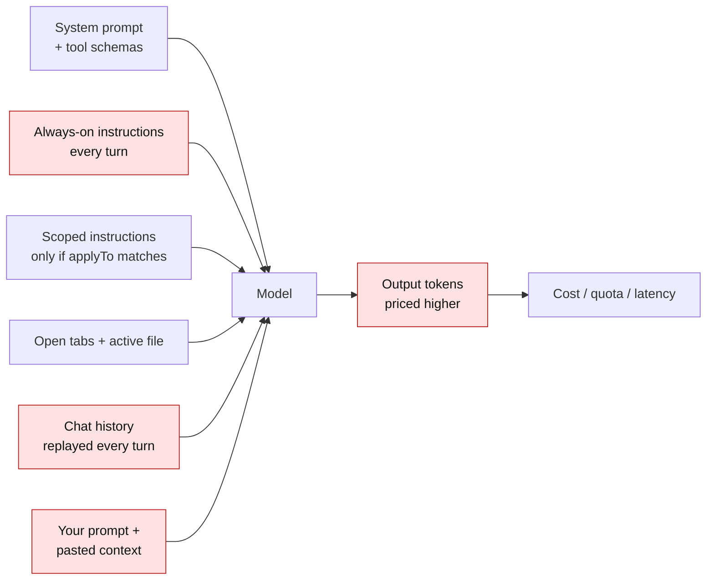
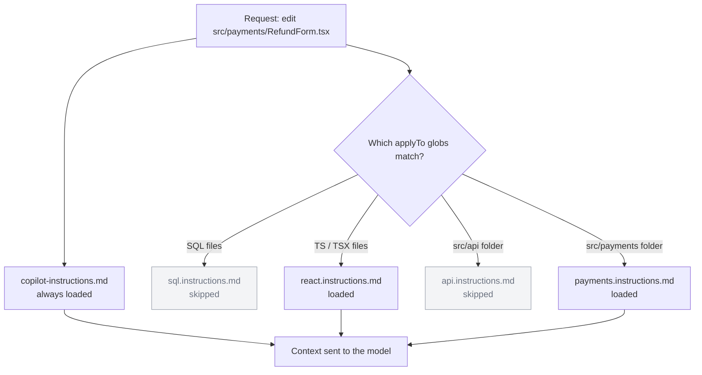
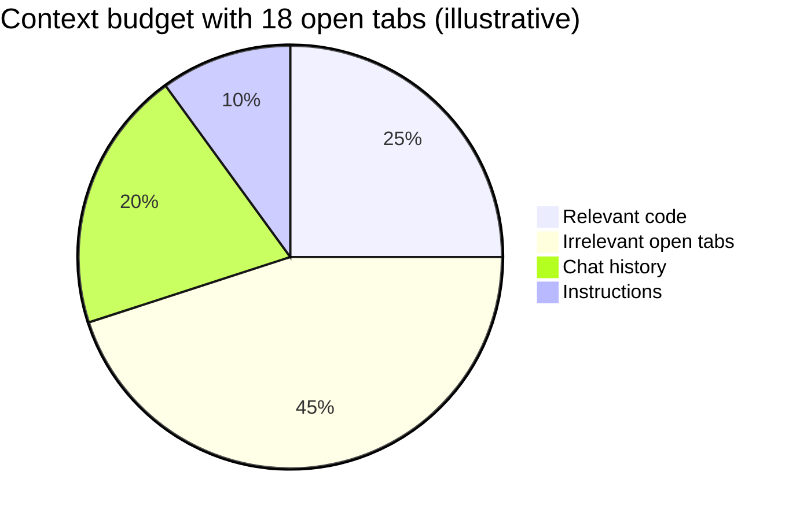
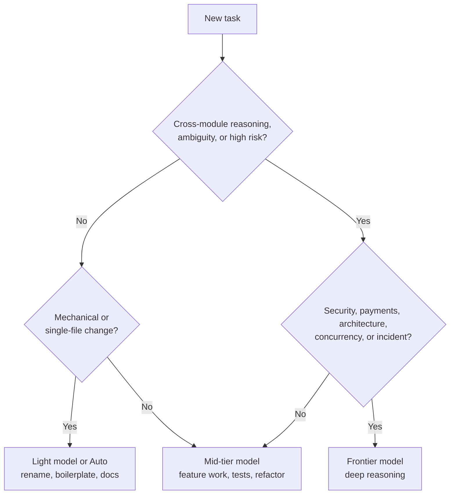
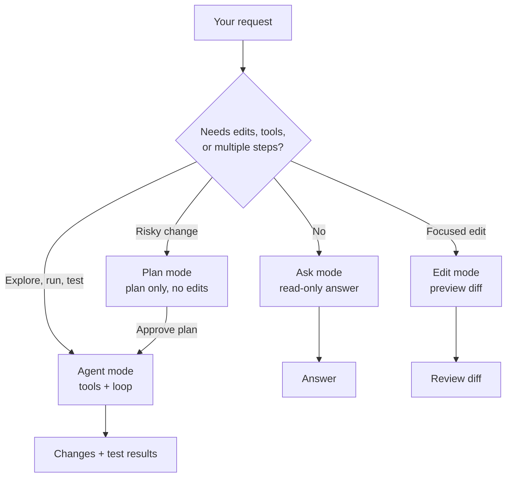
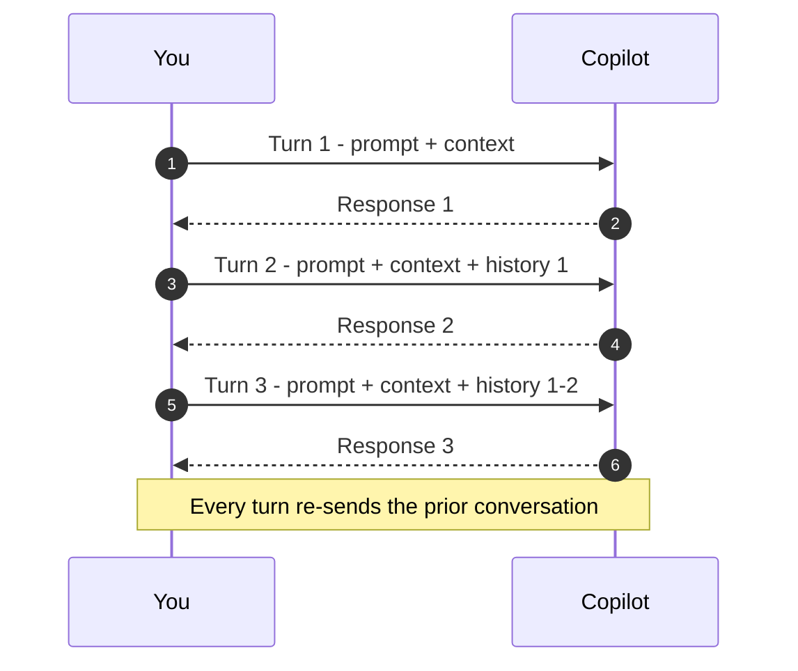
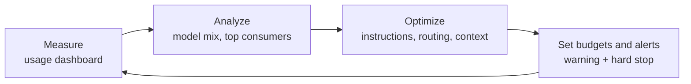
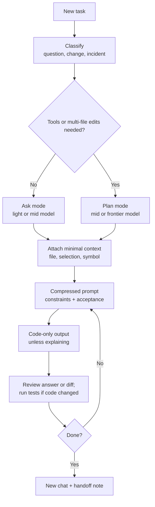

# GitHub Copilot — 10 Token-Saving Tips, Enriched with Examples

**Confluence space:** GenAI / Fintech — Developer tools  
**Audience:** Developers, DevOps, platform engineers  
**Status:** Published  
**Last updated:** 09 November 2026  
**Companion document:** [GitHub Copilot — Team adoption guide](./github-copilot-documentation.md)

---

## 📑 Table of contents

1. [Why this matters](#why)
2. [The cost model in one page](#cost-model)
3. [Tip 1 — Enforce code-only output](#tip-1)
4. [Tip 2 — Use "Caveman Speak" (terse prompting)](#tip-2)
5. [Tip 3 — Trim your global instruction files](#tip-3)
6. [Tip 4 — Scope context using `applyTo`](#tip-4)
7. [Tip 5 — Close unused editor tabs](#tip-5)
8. [Tip 6 — Implement intelligent model routing](#tip-6)
9. [Tip 7 — Avoid pasting entire files into chat](#tip-7)
10. [Tip 8 — Choose Ask mode over Agent mode for simple tasks](#tip-8)
11. [Tip 9 — Start fresh conversations frequently](#tip-9)
12. [Tip 10 — Monitor the usage dashboard](#tip-10)
13. [Putting it all together](#workflow)
14. [Copy-paste templates](#templates)
15. [Quick reference](#quick-reference)
16. [Measurement worksheet](#measurement)
17. [Common failure modes](#failure-modes)
18. [Sources and further reading](#sources)

> **Rendering the diagrams:** This document uses Mermaid. GitHub renders Mermaid natively. In Confluence Cloud, use the Mermaid macro, or paste each block into [mermaid.live](https://mermaid.live) and export an SVG. If your Confluence instance has no Mermaid support, the diagrams remain readable as code blocks.

---

<a id="why"></a>

## Why this matters

The ten tips in this document are all about **token discipline**: sending fewer unnecessary tokens, generating fewer unnecessary tokens, and avoiding paying for the same context over and over.

That discipline matters for three reasons:

1. **Context is finite.** Every irrelevant tab, pasted file, or stale instruction competes with the code that actually matters. More context is not automatically better context.
2. **Chat turns compound.** A chat request re-sends the system prompt, instruction files, attached context, and prior conversation history. A file pasted once into a 10-turn thread can be paid for 10 times.
3. **Cost and latency follow tokens.** Output tokens are usually priced several times higher than input tokens. Even on a flat-rate Copilot plan, token-heavy requests burn premium-request quotas, hit context limits sooner, and produce slower, noisier answers.

> **Copilot billing reality check:** Most GitHub Copilot plans are not metered purely per token. You pay a subscription and consume **premium requests** or **AI credits**, and organizations may have usage-based billing. The exact unit varies by plan and by date. Token discipline still helps because it reduces quota burn, latency, context pressure, retries, and — for token-billed workloads — direct cost.

> **Scope:** These tips focus on Copilot Chat and agent workflows, where context and conversation history are re-sent. Inline completions (ghost text) use a different request model; treat the chat-specific numbers as chat-specific.

### What the ten tips optimize

| # | Lever | Main token stream | Typical impact (directional) | Effort |
|---|-------|-------------------|------------------------------|--------|
| 1 | Code-only output | Output | 40–70% less output on coding tasks | 5 min |
| 2 | Compressed prompts | Input (prompt) | 30–50% less prompt text | 10 min |
| 3 | Trim global instructions | Input (every turn) | Proportional to file size; often 5–10× on the always-on block | 30 min |
| 4 | Scoped instructions | Input (every turn) | Removes rules that do not apply to the current file | 1–2 h |
| 5 | Tab hygiene | Input (every turn) | Largest gains with lockfiles, bundles, fixtures, logs | 1 min/day |
| 6 | Model routing | Cost per request | 2–10× on routine tasks (illustrative) | 5 min/task |
| 7 | Minimal context | Input (every turn) | Proportional to pasted volume; often 10× or more | 1 min/prompt |
| 8 | Ask vs Agent mode | Tool-loop overhead | Avoids multi-step replay on simple questions | 10 sec/task |
| 9 | Fresh conversations | History replay | Proportional to thread length | 5 sec/task |
| 10 | Usage monitoring | All streams | Finds the few habits causing most of the spend | 30 min/week |

> **About the percentages:** They come from the original tips and from typical team experience. Treat them as planning assumptions, not guarantees. Measure on your own tasks before publishing hard targets.

> **If you only do three things:** trim the global instruction file to universal rules, default to code-only output, and start a new chat when the task changes.

### Diagram index

| Diagram | Section | What it shows |
|---------|---------|---------------|
| Cost anatomy | [The cost model](#cost-model) | Which token streams feed a request |
| Scoped instruction routing | [Tip 4](#tip-4) | How `applyTo` loads or skips rule files |
| Context budget | [Tip 5](#tip-5) | How irrelevant tabs can dominate a prompt |
| Model routing | [Tip 6](#tip-6) | Choosing light, mid, or frontier |
| Mode choice | [Tip 8](#tip-8) | Ask vs Edit vs Agent vs Plan |
| History replay | [Tip 9](#tip-9) | Why long threads get heavier |
| Usage review loop | [Tip 10](#tip-10) | Measure, analyze, optimize, set budgets |
| End-to-end workflow | [Putting it all together](#workflow) | How the ten habits combine |

---

<a id="cost-model"></a>

## The cost model in one page

### The basic formula

```text
request_tokens = system_prompt
               + global_instructions
               + scoped_instructions
               + open_editor_context
               + retrieved_or_pasted_files
               + conversation_history
               + your_prompt

output_tokens  = the model's response

cost = request_tokens × input_price
     + output_tokens  × output_price
```

The original Tip 1 assumes output tokens cost **5×** input tokens. That is a useful planning ratio. Actual ratios vary by model — often roughly 4–8× — so check the price sheet for the model you use.

The important consequence: **one output token costs as much as several input tokens.** A short answer is not just tidier; it is cheaper than a long one by the same multiple.

### Worked example (illustrative prices)

Assume $3 per million input tokens and $15 per million output tokens (a 5× ratio).

| Scenario | Input tokens | Output tokens | Input cost | Output cost | Total |
|----------|-------------:|--------------:|-----------:|------------:|------:|
| Verbose answer | 6,000 | 800 | $0.018 | $0.012 | **$0.030** |
| Code-only answer | 6,000 | 200 | $0.018 | $0.003 | **$0.021** |

The output shrank by 75%, and the total request cost fell by 30%. Input tokens dominated this particular request. In a long chat with a large instruction file, input dominates even more; in a chatty explanation, output does.

### The compounding rule

A token that is present on **every turn** is not paid once. It is paid once per turn.

```text
extra_tokens_per_turn × turns_per_day × developers × working_days
```

Example: 2,000 extra tokens of always-on instructions, 50 turns per day, 20 developers, 20 working days:

```text
2,000 × 50 × 20 × 20 = 40,000,000 extra input tokens per month
```

That is why Tip 3 (trim the global file) and Tip 5 (close irrelevant tabs) have outsized returns: they remove tokens from **every** request, not just one.

### Where the tokens go



> **Fintech guardrail:** Token optimization never overrides security. Never paste PANs, IBANs, KYC documents, access tokens, or production customer data into a prompt to "save time." Use synthetic fixtures and redacted logs. Closing a tab is hygiene, not a security control — use Copilot content exclusion and secret scanning for that.

---

<a id="tip-1"></a>

## Tip 1 — Enforce code-only output

> **Original tip:** Output tokens cost five times more than input tokens. Adding a rule like "code only, no explanation" to your instruction file can reduce output by 40% to 70% on every coding task.

### What it means

Make **code, diffs, commands, and test results** the default response format. Remove greetings, preambles, restatements of the request, and post-code summaries. Keep prose only when the task is inherently explanatory.

### Why it works

- Output tokens are the expensive stream.
- Most coding tasks do not need a prose wrapper; the diff is the answer.
- Shorter responses are faster to review and less likely to bury a risky change in a wall of text.
- Less output also means less scrolling, less copy-paste, and fewer follow-up corrections.

> **Billing note:** On a flat-rate or premium-request plan, a shorter answer does not usually reduce the number of requests you are charged for. It reduces latency, context pressure, and the chance of hitting limits. On token-billed workloads, it reduces direct cost.

### Copilot implementation

**Option A — repository-wide default.** Add this to `.github/copilot-instructions.md`:

```markdown
## Output style
- Default: code only. No preamble, no explanation, no summary.
- If a change is risky or ambiguous, add one `// REVIEW:` comment in the code.
- Exception: explain when the user asks "explain", "why", "review", or "compare".
```

**Option B — task-level prefix.** Start a chat with:

```text
[CODE ONLY] Add an idempotency key check to POST /refunds.
No explanation. Add `// REVIEW:` for assumptions.
```

**Option C — a reusable custom prompt.** Save the code-only rule as a custom prompt or command for recurring implementation work, and keep a separate review prompt that explicitly allows prose.

### Example: before and after

**Before — a typical 400-word answer (excerpt)**

```text
Sure! I'd be happy to help. The refund endpoint currently lacks idempotency
protection, which means a retried request can create a duplicate refund.
There are several ways to solve this. One common approach is to use a
Redis-backed idempotency store. You would typically...
[300+ more words]
```

**After — code only**

```ts
// src/api/refunds/service.ts
export async function refund(input: RefundInput): Promise<RefundResult> {
  const key = input.idempotencyKey;
  if (!key) {
    throw new BadRequestError("idempotencyKey is required");
  }

  const existing = await idempotencyStore.get(key);
  if (existing) {
    return existing; // same result for a retried request
  }

  // REVIEW: confirm 24h TTL matches the payments policy
  const result = await ledger.refund(input);
  await idempotencyStore.set(key, result, { ttlSeconds: 86_400 });
  return result;
}
```

The `// REVIEW:` comment preserves the one piece of information a reviewer needs without paying for a paragraph.

### When code-only is the wrong default

| Task | Code-only? | Why |
|------|-----------|-----|
| Implement a function | ✅ Yes | The diff is the deliverable |
| Rename a variable | ✅ Yes | Mechanical |
| Generate tests | ✅ Yes | Test code plus test names |
| Code review | ❌ No | Findings need severity and rationale |
| Architecture decision | ❌ No | Trade-offs are the deliverable |
| Incident analysis | ❌ No | Sequence, impact, and root cause matter |
| Security review | ❌ No | "No findings" without reasoning is dangerous |
| Onboarding a new teammate | ❌ No | Explanation is the point |

### Guardrails

- **Do not let code-only suppress tests.** The rule is about prose, not about skipping acceptance criteria.
- **Keep risky assumptions visible.** A single `// REVIEW:` comment is cheap insurance.
- **Use an explicit exception for reviews.** A review that returns only a patch hides the reasoning behind a security decision.
- **Measure quality, not just length.** Compare acceptance-test pass rate before and after. A shorter answer that breaks the build is not a saving.

### Measure it

Pick ten representative coding tasks. Run five with the old style and five with code-only. Compare:

- output tokens (or response length),
- time to review,
- number of follow-up prompts,
- acceptance-test pass rate.

If output falls by 50% but follow-ups double, the net saving may be zero. The goal is **fewer tokens per accepted change**, not fewer tokens per answer.

---

<a id="tip-2"></a>

## Tip 2 — Use "Caveman Speak" (terse prompting)

> **Original tip:** Eliminate polite, full-sentence conversational filler. Compressed directive prompts reduce input tokens by 30% to 50% without sacrificing response quality.

### What it means

"Caveman Speak" does **not** mean broken grammar or cryptic fragments. It means **telegraphic, front-loaded, directive language**:

```text
VERB + TARGET + CONSTRAINTS + ACCEPTANCE + OUTPUT FORMAT
```

Drop the pleasantries, the hedging, and the restatement of context the model can already see. Keep every word that changes the answer.

### Example: verbose vs compressed

**Verbose — ~60 words**

```text
Hi Copilot, I was wondering if you could please help me refactor the currency
conversion function in our payments service. It's been a while since we touched
it, and I think it could be cleaner. Could you make it better without changing
the public API, and maybe add some tests? Thanks so much!
```

**Compressed — ~20 words**

```text
Refactor `convertCurrency()` in `src/pricing/convert.ts`.
Keep public API. Use `Money`. No new deps.
Add rounding + missing-rate tests. Code only.
```

The second prompt keeps the target, the constraints, the acceptance criteria, and the output format. It removes only filler.

### The prompt template

```text
[VERB] [TARGET].
Constraints: [must / must not].
Acceptance: [behavior + tests].
Output: [format + length].
```

A filled-in fintech example:

```text
[CODE ONLY]
Add idempotency key validation to POST /refunds.
Context: #file:src/api/refunds/controller.ts #file:src/api/refunds/service.ts
Constraints: reuse RedisIdempotencyStore; 24h TTL; 409 on duplicate; no new deps.
Acceptance: tests for first request, duplicate, expired key; `pnpm test` passes.
Output: code only; `// REVIEW:` for assumptions.
```

### Compression cheat sheet

| Filler | Signal |
|--------|--------|
| "I was wondering if you could please..." | "Refactor..." |
| "It would be great if you could also..." | "Also:" |
| "Make sure that it works correctly" | "Acceptance: tests pass" |
| "I think maybe we should..." | "Use X." |
| "As you know, this is a payments service..." | "Context: payments; PCI scope." |
| "Can you explain in detail..." | "Explain: 5 bullets max." |
| "Sorry to bother you, but..." | (delete) |
| "Here is the code I mentioned..." | `#file:path` |

### What not to compress

- **Identifiers and file paths.** `amountMinor` is not the same as `amount`.
- **Error messages and stack traces.** Exact text is diagnostic evidence.
- **Regulatory and security constraints.** "No PAN in logs" must stay explicit.
- **Acceptance criteria.** "Tests pass" is not optional.
- **Output format.** If you need a table, say so.
- **Ambiguity that changes the design.** A 30-token clarification can prevent a 3,000-token wrong implementation.

> **The cheapest token is the one that prevents a wrong answer.** Compression is not maximization of brevity; it is removal of words that do not affect the result.

### When verbose is actually cheaper

Terse prompting works best for **routine, well-specified** tasks. Use fuller prompts when:

- the domain is new to the model or the team,
- the change is high-risk (payments, auth, migrations),
- multiple valid designs exist and you need the model to reason about trade-offs,
- you are onboarding someone and the explanation is the deliverable.

A short prompt that produces the wrong architecture is more expensive than a long prompt that produces the right one.

### Measure it

Take five prompts you use often. Count characters (roughly 4 characters per token) before and after compression. Then check whether the acceptance-test pass rate and the number of follow-ups stayed the same. If they did, keep the compressed version.

---

<a id="tip-3"></a>

## Tip 3 — Trim your global instruction files

> **Original tip:** Your global instruction file is injected into every single request sent to the model. Keep it under 20 lines and remove any unnecessary AI-generated boilerplate to prevent compounding costs across your team.

### What it means

Global instructions are the rules that apply **everywhere, always**. They are valuable precisely because they are always present — and expensive for the same reason. Every line is sent on every chat turn, for every developer, in every repository where the file applies.

In VS Code, the always-on workspace file is typically `.github/copilot-instructions.md`. Depending on your client and setup, you may also have `AGENTS.md`, a user-level instruction file, or organization-wide instructions. The same economics apply: **always-on content is a per-turn tax.**

### The compounding cost of a bloated file

Assume roughly 12 tokens per line, and 1,000 chat turns (a small team over a few days).

| Always-on block | Tokens per turn (est.) | Tokens over 1,000 turns | Relative |
|-----------------|-----------------------:|------------------------:|---------:|
| 20-line file | ~250 | 250,000 | 1× |
| 100-line file | ~1,250 | 1,250,000 | 5× |
| 500-line file | ~6,000 | 6,000,000 | 24× |
| 10 irrelevant tabs | ~15,000 | 15,000,000 | 60× |

> These are order-of-magnitude estimates, not measurements. Replace the assumptions with your own transcript sizes. The point is the multiplier: the file is not paid once.

### What belongs in the global file

Only rules that are **universal, stable, and behavior-changing**:

- build and test commands,
- language/runtime constraints,
- security non-negotiables,
- branch and commit conventions,
- default output style,
- repository-wide architectural boundaries.

### What to remove

| Remove | Why | Move to |
|--------|-----|---------|
| "You are an expert..." persona | Rarely changes output; pure overhead | Delete |
| Generic clean-code principles | The model already knows them | Delete |
| Lists of tools the model has | The client already provides them | Delete |
| Duplicated README content | Two sources of truth drift | Link to the README |
| Long code examples | Paid every turn; rarely needed | Docs or a scoped file |
| File-type rules (SQL, React, Terraform) | Irrelevant for most requests | Scoped `.instructions.md` (Tip 4) |
| Rules already enforced by linters/CI | Deterministic tools are cheaper and stricter | Linter, formatter, CI, hook |
| Stale architecture notes | Actively misleading | Delete or update |
| Secrets, tokens, customer data | Never allowed | Remove and rotate |

### Before and after

**Before — 120 lines of AI-generated boilerplate (excerpt)**

```markdown
# Copilot Instructions

You are an expert software engineer with 20 years of experience building
scalable, maintainable, production-ready applications. You always write clean,
efficient, and well-documented code. You follow SOLID principles, DRY, KISS,
and YAGNI. You are a helpful assistant who communicates clearly...

[100+ more lines of generic principles, repeated examples, and tool lists]
```

**After — 16 content lines, all universal**

```markdown
# Copilot instructions — payments-api

## Build & test
- Install: `pnpm install --frozen-lockfile`
- Build: `pnpm build`; test: `pnpm test`
- Never run `npm install` or edit lockfiles by hand.

## Code
- TypeScript strict; no `any`; prefer `unknown` + narrowing.
- Money: integer minor units (`amountMinor`), never floats.
- C#: nullable enabled; async methods end with `Async`.

## Security
- No secrets, PANs, IBANs, or customer data in code, logs, fixtures, or prompts.
- Never bypass auth middleware; never disable TLS verification.

## Git
- Branches: `feat/`, `fix/`, `chore/`; commits: Conventional Commits.

## Output
- Code only unless the user asks to explain or review.
```

### The 15-minute audit

1. **Open the file** and number the lines.
2. **Mark each line** as `U` (universal), `S` (scoped), `D` (delete), or `M` (move to another doc).
3. **Delete `D` lines.** Generic personas, tool lists, duplicated README text, stale examples.
4. **Move `S` lines** into scoped instruction files with `applyTo` (Tip 4).
5. **Move `M` lines** into `CONTRIBUTING.md`, ADRs, or runbooks — places humans read, not prompts.
6. **Re-read the remaining `U` lines.** Can any be enforced by a linter or CI? If yes, delete the instruction and add the check.
7. **Commit** the trimmed file and note the change in the team channel.

### A line budget that works

| Content | Target | Where |
|---------|--------|-------|
| Universal build/test/security | 8–12 lines | Global |
| File-type or directory rules | 5–15 lines each | Scoped |
| Task-specific constraints | 3–10 lines | Prompt |
| Multi-step procedures | Any length | Custom prompt, skill, or doc |

> **Do not delete a security rule just to hit 20 lines.** Move it to a scoped file or enforce it with a hook, linter, or CI check. The target is "no always-on content that is not universal," not "20 lines at any cost."

### Guardrails

- **One source of truth.** Do not duplicate the same rule in the global file, a scoped file, and a prompt. Duplication creates drift and conflicts.
- **Review quarterly.** A rule that was true six months ago may now be wrong. Stale instructions are worse than no instructions.
- **No secrets.** Instruction files are versioned and read by the model. Never put credentials, internal URLs with tokens, or customer data in them.
- **Test the trim.** Start a new chat and ask Copilot to perform a task that depends on a rule you kept. If it still follows it, the rule survived. If it does not, the rule was not clear enough.

### Measure it

Count the lines and estimate tokens as `lines × 12`. Multiply by the number of chat turns per developer per day and by the team size. Compare the monthly total before and after the trim. For a token-billed workload, multiply by the input price. For a flat-rate plan, use the number as a proxy for context pressure and quota burn.

---

<a id="tip-4"></a>

## Tip 4 — Scope context using `applyTo`

> **Original tip:** Instead of letting all rules load globally, create separate instruction files with front matter (like `applyTo`) so rules only load when relevant to specific file types (e.g., loading SQL schema rules only when editing SQL files).

### What it means

Keep the **universal** rules in the global file. Move **file-type-specific** and **directory-specific** rules into separate `.instructions.md` files with YAML front matter:

```markdown
---
applyTo: "**/*.sql"
---
```

When a request touches a matching file, the instruction file is loaded. When it does not match, the file is skipped. The result is less irrelevant context on every request and fewer conflicting rules.

> **Client note:** This section describes VS Code's workspace instruction files (`.github/instructions/*.instructions.md`). Other Copilot clients may use different file locations or front matter. Verify the behavior in your IDE before standardizing.

### A practical repository layout

```text
.github/
├── copilot-instructions.md          # always-on, ≤20 lines
└── instructions/
    ├── sql.instructions.md          # **/*.sql
    ├── react.instructions.md        # **/*.{tsx,jsx}
    ├── api.instructions.md          # src/api/**
    ├── payments.instructions.md     # src/payments/**
    └── tests.instructions.md        # **/*.test.ts
```

### Example: SQL rules

```markdown
---
applyTo: "**/*.sql"
---
# SQL rules — ledger and reporting

- Use explicit column lists; never `SELECT *` in application queries.
- Money columns: `NUMERIC(19,4)`; never `FLOAT` or `REAL` for currency.
- Migrations must be idempotent and include a rollback plan.
- Lead tenant-scoped indexes with `tenant_id`.
- Never select or log raw PAN or IBAN; use tokenized references.
```

### Example: React rules

```markdown
---
applyTo: "**/*.{tsx,jsx}"
---
# React rules — payments UI

- Function components and hooks only; no class components.
- Use the design-system `Money` component; never format currency inline.
- Every async state has loading, empty, and error states.
- No `dangerouslySetInnerHTML`; no secrets in client bundles.
- Tests: React Testing Library; query by role or label, not test IDs.
```

### Example: API rules

```markdown
---
applyTo: "src/api/**"
---
# API rules

- Validate request bodies with the shared `zod` schemas.
- Return RFC 7807 problem details; never leak stack traces.
- Every mutating endpoint needs an idempotency key and an audit event.
- Add contract tests for new endpoints.
```

Multiple patterns can be combined. Use brace expansion such as `"**/*.{ts,tsx}"`, or a comma-separated list of globs if your client supports it. Always quote the glob; an unquoted `*` can break YAML parsing.

### How scoped loading works



### Design rules

- **One concern per file.** `sql.instructions.md`, not `everything-database.instructions.md`.
- **Name by domain, not by author.** A file should make sense a year later.
- **Use narrow globs.** `"src/payments/**"` is better than `"**/*"`.
- **Do not duplicate global rules.** Scoped files add; they do not repeat.
- **Keep each file short.** 10–30 lines is usually enough. If it grows, split it.
- **Review quarterly.** Delete files for code that no longer exists.
- **Test both sides.** Open a matching file and a non-matching file; verify the rule appears only where expected.

### Common mistakes

| Mistake | Symptom | Fix |
|---------|---------|-----|
| `applyTo: "*.sql"` | Only root-level SQL files match | Use `"**/*.sql"` |
| Unquoted glob | YAML parse error or silent skip | Always quote the pattern |
| Front matter not first | File is ignored | `---` must be the first line |
| Rules duplicated globally | Conflicts and wasted tokens | Remove from the global file |
| 40 tiny files | Maintenance burden | One file per domain; consolidate |
| Overly broad glob | Rules load for unrelated code | Narrow the path |

### Token impact

Suppose a 200-line global file contains 120 lines of SQL and React rules. Moving those rules into scoped files leaves an 80-line global file. For a request that touches neither SQL nor React, the always-on block shrinks by 60%. For a request that touches one of them, only the relevant scoped file is added.

Scoped instructions save tokens **only if they replace global content**. If you add scoped files on top of an unchanged global file, you have increased the total context and made maintenance harder.

### Guardrails

- **Scoped does not mean secret.** Instruction files are versioned and may be read by the model. No credentials or customer data.
- **Avoid conflicting rules.** If the global file says "always use `SELECT *`" and the SQL file says "never use `SELECT *`," the model gets contradictory guidance. Pick one and delete the other.
- **Do not scope by accident.** A missing `applyTo` may make the file always-on or ignored, depending on the client. Verify.
- **Keep the security baseline global.** Auth, secrets, and data-handling rules should not depend on a glob matching.

---

<a id="tip-5"></a>

## Tip 5 — Close unused editor tabs

> **Original tip:** GitHub Copilot automatically includes nearby open tabs as background context. Keep a maximum of five relevant tabs open to avoid sending unneeded input tokens with every prompt.

### What it means

Copilot can use the active file, the current selection, and other open editors as implicit context. The exact mix depends on the IDE and version; in VS Code, the active editor is always a strong signal, and other open tabs can influence what the model sees. Every irrelevant tab is a chance to send tokens you did not need — and a chance to distract the model from the code that matters.

> **Check your client:** JetBrains, Visual Studio, and the Copilot CLI have different context behaviors. Use the client's context indicator or documentation to see what is attached. The habit is portable even when the mechanics differ.

### The tab audit

| Keep open | Close |
|-----------|-------|
| The file you are editing | `package-lock.json`, `pnpm-lock.yaml`, `yarn.lock` |
| The test file for that code | `dist/`, `build/`, minified bundles |
| The interface/type file | Large CSV/JSON fixtures |
| The relevant config | `.env`, secrets, logs, dumps |
| The PR diff under review | Old versions, unrelated modules |
| The schema or migration | Generated code, snapshots you are not comparing |

Five tabs is a good working limit, not a law. The real rule is: **every open tab should be plausible context for the current task.**

### Example: the 18-tab prompt

You are working on the refund endpoint. Your tabs:

```text
payments.service.ts          ← the file you need
refund.controller.ts         ← relevant
refund.service.test.ts       ← relevant
redis-idempotency.ts         ← relevant
package-lock.json            ← 12,000 lines of noise
fixtures/transactions.csv    ← 8,000 rows of synthetic data
dist/bundle.js               ← minified build output
.env.local                   ← secrets you should not have open
legacy/OrderService.cs       ← unrelated old module
...
```

You ask:

```text
Why is the refund endpoint returning 500 after a retry?
```

With all 18 tabs open, the model may pull in the fixture schema, the lockfile, or the old module. At best, those tokens dilute the answer. At worst, the model anchors on the wrong code — and you have exposed a local secrets file to the context window.

With four relevant tabs open, the same question has a much cleaner signal.

### Illustrative context budget



The numbers are illustrative, not measured. The shape is the point: irrelevant tabs can be the largest single block.

### Better habits

1. **Close at the end of each task.** Before starting a new feature, close the old cluster of tabs.
2. **Use a task-specific window.** Open a new VS Code window (or profile) for a new task instead of carrying 20 tabs.
3. **Exclude generated files.** Add `dist`, `build`, `coverage`, and lockfiles to `files.exclude` / `search.exclude` so they are less likely to be picked up.
4. **Attach deliberately.** Use `#file`, `#selection`, and `#sym` for the exact context you need instead of hoping the tab bar does it.
5. **Keep secrets out of the editor.** Use environment variables, a secrets manager, and content exclusion. Do not rely on closing a tab after the fact.

### Security note

If a secret was open in a tab while you used Copilot, **rotate it**. Closing the tab does not undo the exposure. For organization-wide protection, configure Copilot content exclusion for sensitive paths, and keep secret scanning enabled. Tab hygiene reduces accidental context; it is not a data-loss-prevention control.

### Measure it

Compare two sessions on the same task: one with 15+ tabs open, one with five relevant tabs. Track:

- response relevance (did the model cite the right files?),
- number of follow-up prompts,
- response length,
- any irrelevant file references.

If the five-tab session needs fewer corrections, the saving is real even before you count tokens.

---

<a id="tip-6"></a>

## Tip 6 — Implement intelligent model routing

> **Original tip:** Match tasks to the lightest model capable of handling them. Save frontier models (like Claude Opus or GPT-5) for complex reasoning, and use lighter models (like Haiku or GPT-4o Mini) for routine tasks like variable renames.

### What it means

Not every task deserves the most expensive reasoning engine. Route by **task class**:

- **Light tier** — mechanical transformations, boilerplate, commit messages, simple explanations, variable renames.
- **Mid tier** — feature work in a known pattern, unit tests, bounded refactors, stack-trace analysis.
- **Frontier tier** — cross-module reasoning, ambiguous requirements, architecture, concurrency, security, financial correctness, incident root cause.

### A routing table you can use

| Task | Example | Recommended tier | Why |
|------|---------|------------------|-----|
| Rename a variable | `amt` → `amountMinor` across 3 files | Light | Pattern matching; low ambiguity |
| Generate a commit message | Summarize a staged diff | Light | Text transformation |
| Write boilerplate | A new DTO, mapper, or test skeleton | Light | Templated |
| Explain a short function | "What does this regex do?" | Light or mid | Bounded reasoning |
| Add a unit test | Cover rounding and missing-rate cases | Mid | Needs domain context |
| Refactor within a module | Split a 200-line service | Mid | Local reasoning |
| Debug a failing test | Read the stack trace and the test | Mid | Diagnostic, but bounded |
| Refactor across modules | Change refund flow across 5 files | Mid or frontier | Cross-file consistency |
| Design idempotency | Ledger writes, retries, duplicates | Frontier | Correctness and concurrency |
| Security review | Auth change, token handling | Frontier | Risk is asymmetric |
| Incident root cause | Production payment failure | Frontier | Ambiguity and impact |

> **Model availability changes.** The names in the original tip are examples, not a fixed catalog. Check the Copilot model picker for the models your plan and organization allow, and note the cost or multiplier shown there. Do not hard-code model names into global instructions; route by task class instead.

### Decision tree



### A simple routing rule

1. **Can you describe the change as a deterministic transformation?** Rename, format, generate boilerplate, write a commit message → **light**.
2. **Does it need local reasoning across a few files, tests, or a known pattern?** → **mid**.
3. **Does it need cross-module reasoning, ambiguity resolution, or correctness under risk?** → **frontier**.
4. **Unsure?** Start with **Auto**, then escalate after a failed attempt. Do not loop a weak model on a hard problem.

### Illustrative cost impact

Suppose 100 routine requests per day. If a frontier model consumes 10 cost units per request and a light model consumes 1, the daily difference is:

```text
Frontier: 100 × 10 = 1,000 units
Light:    100 ×  1 =   100 units
Saving:   900 units (90%)
```

The 10× multiplier is illustrative. The principle is real: **do not pay frontier rates for work a light model can do.** Check the actual multiplier in your Copilot model picker.

### Quality guardrails

- **Never route security reviews, payment correctness, or incident root cause to a light model just to save credits.** A missed vulnerability costs more than the entire quota.
- **Escalate after one failed attempt.** A second attempt with a stronger model is usually cheaper than five retries with a weak one.
- **Judge by accepted changes, not by tokens.** Track acceptance-test pass rate and review comments.
- **Keep routing out of the global instruction file.** Model names change; task classes do not.
- **Respect organization policy.** Some models may be disabled for data-handling or compliance reasons.

### Anti-patterns

| Anti-pattern | Why it hurts |
|--------------|--------------|
| Frontier model for commit messages | Pure waste; the task is text transformation |
| Light model for a ledger migration | High risk of a subtly wrong money calculation |
| Same model for every task | You either overspend or underpower |
| Switching models mid-task without a reason | Loses context and makes comparison impossible |
| Hard-coding a model name in instructions | Breaks when the catalog changes |

### Measure it

For one week, label each request by task class and model tier. Compare:

- cost units per task class,
- acceptance-test pass rate,
- number of follow-ups,
- review findings.

If a task class has the same pass rate on a lighter tier, move it down. If it has more follow-ups, move it back up. Routing is an experiment, not a religion.

---

<a id="tip-7"></a>

## Tip 7 — Avoid pasting entire files into chat

> **Original tip:** Pasting a massive 500-line file wastes thousands of input tokens on irrelevant context. Use hash-file references or highlight only the specific lines you need to discuss.

### What it means

Pasting a file feels precise, but it is usually the opposite: it sends **everything** — imports, comments, unrelated methods, dead code — and it stays in the conversation history. A 500-line file is roughly 5,000–8,000 tokens. Paste it into a 10-turn thread and you may pay for 50,000–80,000 tokens of mostly irrelevant context.

Better: attach the **smallest unit that answers the question**.

### Context references in Copilot Chat

| Need | Reference | Example |
|------|-----------|---------|
| A whole file (small) | `#file` | `#file:src/pricing/convert.ts` |
| Specific lines | Select them, then use `#selection` | Select lines 42–68 |
| A symbol | `#sym` | `#sym:RefundService.refund` |
| Search the repo | `#codebase` | "Where is the idempotency key validated?" |
| A failing test | `#testFailure` | Attach the failure output |
| The last terminal error | `#terminalLastCommand` | Attach the command output |
| Lint/type problems | `#problems` | Attach current diagnostics |

> **Client note:** Available context references vary by client and version. Type `#` in the chat input to see the list for your IDE, and use the reference names your client actually supports.

> **Important nuance:** `#file` can still attach the whole file. It is cleaner and more explicit than pasting, but it is not automatically cheaper. For large files, use `#selection`, a symbol reference, or a line range. `#codebase` uses retrieval to send relevant chunks; verify that the chunks it picked are actually relevant.

### Before and after

**Bad — 500-line dump**

```text
Here is my entire OrderService.cs. Why is refund failing?

[500 lines of code, including unrelated order-creation paths,
legacy methods, imports, and comments]
```

**Good — minimal, targeted context**

```text
Refund fails with InvalidOperationException after a payment is captured.
Stack: #terminalLastCommand
Code: #sym:RefundService.RefundAsync
Focus: lines 142–168 (idempotency + capture state).
Question: what sequence causes the guard to throw? Answer in 5 bullets.
```

The second prompt sends the failing method and the actual error, not the entire service. It is easier to read, cheaper, and more likely to produce a precise answer.

### Token math

| Context | Approximate tokens | If replayed for 10 turns |
|---------|-------------------:|-------------------------:|
| 500-line file | 6,000 | 60,000 |
| 25-line method + stack trace | 500 | 5,000 |
| 20-line diff | 250 | 2,500 |

The saving is not just the first prompt. It compounds across the thread.

### A redaction checklist

Before attaching anything from a real system:

- [ ] Remove PANs, IBANs, account numbers, and customer identifiers.
- [ ] Remove access tokens, session IDs, and API keys.
- [ ] Replace production data with synthetic values of the same shape.
- [ ] Keep the structure: column names, types, and error messages are often the useful part.
- [ ] Scrub logs; do not paste raw production logs with PII.
- [ ] Check that the file is not excluded by organization policy.

> **Synthetic data beats redaction.** If you need a realistic fixture, generate one. Redaction is error-prone, especially with free-text fields.

### Context patterns that work

**Pattern 1 — symbol plus failure**

```text
#sym:RefundService.RefundAsync
#terminalLastCommand
Why does the guard throw after capture? 5 bullets max.
```

**Pattern 2 — selection plus question**

```text
#selection
This query is slow in production. Which index would help?
Explain in 3 bullets; no code changes yet.
```

**Pattern 3 — codebase search plus file**

```text
#codebase Where is the idempotency key validated?
Then open #file:src/api/refunds/service.ts and confirm the order of checks.
```

**Pattern 4 — diff review**

```text
#file:src/api/refunds/service.ts
Review only the changed lines in this diff. Findings first, patch second.
```

### Common mistakes

| Mistake | Consequence | Better approach |
|---------|-------------|-----------------|
| Pasting the whole file "to be safe" | Thousands of irrelevant tokens; model anchors on noise | Attach the method or selection |
| Pasting a minified bundle | Huge token count, almost no signal | Attach the source file |
| Pasting raw production logs | PII/secrets exposure | Redact or synthesize |
| Using `#file` for a 2,000-line file | Still expensive | Use `#sym` or a line range |
| Attaching 10 files "just in case" | Context dilution | Start with 1–2; add on demand |

### Guardrails

- **Minimal context improves quality, not just cost.** The model is less likely to anchor on unrelated code.
- **Do not paste a whole repository.** Use `#codebase` for retrieval, then narrow.
- **Never paste secrets or customer data.** If it happened, rotate the secret and follow the incident process.
- **Cite lines in your question.** "Lines 142–168" focuses the answer and makes review easier.

### Measure it

Compare a 500-line paste with a symbol-based prompt on the same bug. Track:

- answer accuracy (did it identify the actual cause?),
- number of follow-ups,
- response length,
- time to a fix.

In most cases, the smaller prompt wins on all four.

---

<a id="tip-8"></a>

## Tip 8 — Choose Ask mode over Agent mode for simple tasks

> **Original tip:** Agent mode carries heavy token overhead because it loads workspace tools and replays conversation steps repeatedly. Use standard Ask Mode for quick questions.

### What it means

Copilot's modes have different cost profiles because they do different amounts of work:

- **Ask** — answer a question using context. Read-only; no file edits, no tool loop.
- **Edit** — apply a focused change across selected files, with a diff to review. No autonomous tool loop.
- **Agent** — plan, read files, edit, run commands/tests, inspect results, and iterate. Powerful and token-heavy.
- **Plan** — explore and produce a plan without editing; useful before a risky Agent run.

Mode names and availability vary by client. The principle is stable: **the more autonomy, the more tokens.**

### What each mode loads

| Mode | Context and tools | Can edit files? | Can run commands? | Best for |
|------|-------------------|-----------------|-------------------|----------|
| Ask | Question + attached context + model | No | No | Explanations, quick questions, reviews |
| Edit | Selected files + model + diff | Yes, with preview | No | Focused multi-file edits |
| Agent | Workspace context + tool schemas + loop | Yes | Yes, with permission | Exploration, implementation, tests |
| Plan | Read-only exploration + model | No | No | Designing a change before Agent |

### Why Agent mode costs more

1. **Tool schemas.** The model receives definitions for file editing, search, terminal, tests, and more.
2. **Multi-step loop.** Read → edit → run → read output → fix. Each step re-sends context.
3. **Diffs and command output.** Test failures, build logs, and file diffs are large.
4. **Permission prompts.** Each approval is another interaction.
5. **Retries.** A failing test can trigger several rounds of edits.
6. **Longer outputs.** Plans, summaries, and explanations of what changed.

None of this is waste when the task needs autonomy. It is waste when the task is a one-line question.

### Decision guide



### Examples

**Ask mode — a question**

```text
[ASK]
Why does this SQL query use a sequential scan?
Context: #file:db/queries/ledger_summary.sql
Answer in 5 bullets. Cite the relevant predicates.
```

**Ask mode — a review before editing**

```text
[ASK]
Review this diff for idempotency and authorization bugs.
Findings first, severity and file:line. Do not write a patch yet.
```

**Edit mode — a focused change**

```text
[EDIT]
Rename `amt` to `amountMinor` in these three files:
#file:src/pricing/convert.ts
#file:src/pricing/round.ts
#file:src/pricing/convert.test.ts
Show the diff. No behavior changes.
```

**Agent mode — a task that needs exploration and tests**

```text
[AGENT]
Goal: add idempotency key validation to POST /refunds.
Constraints: reuse RedisIdempotencyStore; 24h TTL; 409 on duplicate; no new deps.
Acceptance: unit + integration tests pass; `pnpm test`.
Guardrails: do not change the public API; do not run migrations.
Start with a plan. Wait for approval before editing.
```

**Plan mode — de-risk before Agent**

```text
[PLAN]
Design the migration plan for adding `tenant_id` to the ledger table.
No edits. List steps, risks, rollback, and the tests we need.
```

### The cost-saving habit

1. **Start with Ask** to understand the problem and scope the change.
2. **Switch to Plan** if the change is risky or crosses modules.
3. **Use Edit** for a controlled, local change.
4. **Use Agent** only when the task needs exploration, command execution, or test iteration.
5. **Approve the plan before the loop.** A 30-second plan review can prevent a 10-step detour.

### Guardrails

- **Clean git state.** Commit or stash before an Agent run so you can review or revert.
- **Work on a branch.** Never let an agent make destructive changes on `main`.
- **Approve commands individually.** Do not blanket-approve terminal access.
- **Do not let Agent run migrations or destructive SQL** without a human review.
- **Review the diff, not the summary.** The model's description of what it did is not evidence.
- **Run tests yourself.** A green summary from the agent is not a substitute for CI.

### Measure it

Compare Ask and Agent on the same simple question (for example, "what does this function do?"). Track:

- response time,
- tokens or cost units,
- whether any file changed (it should not),
- answer quality.

Then compare them on a task that genuinely needs tools. The point is not "Agent bad" — it is "use the cheapest mode that can finish the task."

---

<a id="tip-9"></a>

## Tip 9 — Start fresh conversations frequently

> **Original tip:** Every message sent in a chat thread resends the entire conversation history, making later messages significantly more expensive. Use your editor's reset shortcut (e.g., Ctrl+L / Cmd+L in VS Code) for a zero-cost token reset on new tasks.

### What it means

A chat thread is not a database with a free index. On every turn, the client sends the prior conversation — your messages, the model's answers, tool results, diffs, and error output — back to the model. The longer the thread, the more history is replayed, and the more likely the model is to latch onto stale assumptions.

Starting a new chat resets that history. Your **workspace instructions and repository files remain**; only the conversation is cleared.

### How history replay works



The later turns are not just "one more message." They carry everything that came before.

### Thread length and replay

| Turn | Prior messages replayed | Relative input per turn (illustrative) |
|-----:|------------------------:|------------------------------:|
| 1 | 0 | 1× |
| 5 | 4 | ~5× |
| 10 | 9 | ~10× |
| 20 | 19 | ~20× |
| 40 | 39 | ~40× |

The multiplier is approximate: message lengths vary, and prompt caching may reduce the effective cost. The direction is reliable — **long threads get heavier**.

### When to start fresh

- You are starting a **new task** with different files or a different goal.
- You **finished a PR** and are moving to the next one.
- An approach **failed** and you want to try a different design.
- The model starts **repeating itself**, forgetting constraints, or mixing up files.
- The thread is **long and noisy** — a rough heuristic is 15–20 turns, but quality matters more than a fixed number.
- You are about to paste a large new context that would coexist with a lot of stale history.

### How to hand off context

Do not lose the decisions. Write a five-line handoff and paste it into the new chat:

```text
[NEW CHAT HANDOFF]
Task: add a changelog entry for refund idempotency.
Repo/branch: payments-api / feat/refund-idempotency.
Decisions: Redis SETNX; 24h TTL; 409 on duplicate; no public API change.
Files: #file:CHANGELOG.md #file:src/api/refunds/service.ts
Do: add one bullet under Unreleased > Fixed. Code only.
```

This is cheaper than replaying 20 turns of debugging, and it forces you to state the decisions that actually matter.

### Keyboard shortcuts and commands

Shortcuts vary by client and keymap. In VS Code, use the **New Chat** command from the Command Palette (search for "Chat: New Chat") or the **+** button in the Chat view. Some Copilot clients use `Ctrl+L` / `Cmd+L`; others use a different binding. Check **Keyboard Shortcuts** rather than trusting a blog post.

In the Copilot CLI, `/clear` starts a fresh conversation. In clients that support compaction, `/compact` summarizes the current thread instead of clearing it — useful for a long-running task, but a fresh chat is better when the task has changed.

> **What persists:** workspace instructions, repository files, and any context you explicitly attach. **What does not:** the conversation history. That is exactly the reset you want.

### What not to do

| Anti-pattern | Why it hurts |
|--------------|--------------|
| Keeping a 40-turn thread "because it knows the context" | You pay for the history on every turn, and stale assumptions persist |
| Starting fresh with no handoff | You lose decisions and re-explain everything |
| Using a fresh chat for a task that depends on the current diff | The model no longer sees the diff unless you attach it |
| Clearing the chat to avoid a difficult question | A new chat does not fix an ambiguous prompt |

### Compaction vs fresh chat

| Need | Use |
|------|-----|
| Continue the same task, but free context | Compact (if supported) |
| Start a different task | New chat + handoff |
| Remove a wrong assumption | New chat; restate the correct constraint |
| Reduce cost on a long thread | New chat; summarize decisions first |

### Measure it

Track the average number of turns per task and the average thread length at closure. A team that closes tasks in 6 focused turns will usually spend less than a team that drifts for 25. The goal is not "always start fresh"; it is **fresh context for a fresh task**.

---

<a id="tip-10"></a>

## Tip 10 — Monitor the usage dashboard

> **Original tip:** Track your real-time AI credit consumption and set budgets or alerts to stay on top of your usage under the billing model.

### What it means

You cannot optimize what you do not measure. Copilot usage dashboards show how much of your plan's quota is being consumed, which models are used, and — for organizations — which teams and repositories drive usage. Use them to find the few habits that cause most of the spend.

> **Where to look:** The exact menus vary by plan and by date. Check your personal GitHub settings for Copilot usage, and your organization's Copilot usage metrics or billing page for aggregate data. In the IDE, `/usage` may show session-level information in clients that support it. Do not publish menu paths without verifying them against your current plan.

### What to monitor

| Metric | Why it matters | Action if it is high |
|--------|----------------|----------------------|
| Premium requests / AI credits per developer | Direct quota consumption | Inspect top consumers and task mix |
| Model mix (frontier vs light) | Frontier models cost more per request | Route routine tasks down |
| Agent-mode share | Agent loops consume more tokens | Use Ask/Edit for simple tasks |
| Average turns per task | History replay | Better prompts; fresh chats |
| Global instruction file size | Always-on cost | Trim and scope |
| Requests per merged PR | Efficiency | Investigate outliers |
| Cost per accepted change | Quality-adjusted cost | Optimize without harming quality |
| Failed/retried requests | Wasted spend | Fix prompts, context, or tool setup |

### A weekly 15-minute review

1. **Read the dashboard.** Note total usage, model mix, and the top three consumers.
2. **Compare to last week.** Is the change explained by a release, an incident, or a habit?
3. **Find one routing waste.** Frontier model on commit messages, boilerplate, or simple explanations.
4. **Find one context waste.** A 300-line instruction file, a 30-turn thread, or a pasted 500-line file.
5. **Check budgets and alerts.** Set thresholds at warning and hard-stop levels if your plan supports them.
6. **Share one win.** A short note in the team channel is more effective than a policy document.



### Budgets and alerts

Organization owners can often set spending budgets and alerts; individual plans have quotas rather than a monthly budget. Use two thresholds:

- **Warning** — investigate before the quota is exhausted.
- **Hard stop** — prevent surprise overages, but exempt security-critical work.

> **Do not set a budget so low that a security review or incident response is blocked.** Cost control is subordinate to risk control.

### An illustrative team review

A payments team notices that 60% of premium requests come from three developers. The audit finds:

- they use a frontier model for test generation and commit messages,
- they keep 25–30 turn threads for unrelated tasks,
- their global instruction file is 180 lines, half of it SQL rules.

The fixes:

- route test generation and commit messages to a light model or Auto,
- start a new chat per PR with a five-line handoff,
- move SQL rules into `sql.instructions.md` with `applyTo`.

Result (illustrative): 25% lower usage with no change in acceptance-test pass rate. The exact number will vary; the method is what matters.

### Avoid vanity metrics

Token spend alone is a bad target. A team can cut usage by asking fewer questions, using weaker models for risky work, or skipping tests — and be worse off. Track **cost per accepted change** alongside:

- acceptance-test pass rate,
- review findings per PR,
- time to merge,
- developer satisfaction,
- incident rate.

### Guardrails

- **Do not publish individual usage rankings** without context; they encourage gaming and punish legitimate heavy work.
- **Do not optimize security-critical work for cost.** A review that catches one vulnerability pays for a lot of quota.
- **Do not compare teams with different work.** A platform team and a feature team have different task mixes.
- **Re-baseline after model or pricing changes.** The dashboard is only comparable over time if the units are stable.

---

<a id="workflow"></a>

## Putting it all together

The tips are not independent. A good default workflow combines them:



### The ten tips as a checklist

| # | Ask yourself | Action |
|---|--------------|--------|
| 1 | Does this answer need prose? | Default to code-only; allow prose for reviews and explanations |
| 2 | Can I say this in fewer words without losing constraints? | Use `VERB + TARGET + CONSTRAINTS + ACCEPTANCE + OUTPUT` |
| 3 | Is every global rule universal? | Delete, move, or scope the rest |
| 4 | Is this rule only relevant to a file type or folder? | Move it to an `.instructions.md` with `applyTo` |
| 5 | Are all open tabs plausible context? | Keep ≤5 relevant tabs; close generated files and fixtures |
| 6 | Is this task routine or high-risk? | Route to light, mid, or frontier accordingly |
| 7 | Am I pasting more than I need? | Use `#file`, `#selection`, `#sym`, `#codebase` |
| 8 | Does this task need tools or edits? | Ask for questions; Edit for focused changes; Agent for exploration and tests |
| 9 | Is this a new task? | Start a new chat; write a five-line handoff |
| 10 | Do I know what this is costing? | Review usage weekly; set budgets and alerts |

### 30-day rollout plan

| Week | Actions | Success signal |
|------|---------|----------------|
| 1 | Capture a baseline; trim the global file; add the code-only rule; do a tab audit | Global file ≤20 lines; baseline recorded |
| 2 | Add scoped instructions for the top 3 file types; compress recurring prompts | Irrelevant rules no longer load |
| 3 | Introduce model routing; use Ask/Edit/Agent deliberately; attach minimal context | Routine tasks run on light/Auto; fewer Agent loops |
| 4 | Make fresh chats a habit; review the usage dashboard; share one win | Lower cost per merged PR; quality unchanged or better |

### Definition of done

- [ ] Global instruction file is ≤20 lines and contains only universal rules.
- [ ] The top three file types or directories have scoped instruction files.
- [ ] Code-only is the default, with explicit exceptions for reviews and explanations.
- [ ] The team knows which tasks go to light, mid, and frontier models.
- [ ] Every developer can use `#file`, `#selection`, `#sym`, and `#codebase`.
- [ ] Ask, Edit, Agent, and Plan modes are used deliberately, not by habit.
- [ ] New tasks start in a new chat with a short handoff.
- [ ] A weekly usage review is on the calendar, with budgets or alerts configured.
- [ ] Security rules are never weakened to save tokens.

---

<a id="templates"></a>

## Copy-paste templates

### Global instruction file (≤20 lines)

```markdown
# Copilot instructions — payments-api

## Build & test
- Install: `pnpm install --frozen-lockfile`
- Build: `pnpm build`; test: `pnpm test`
- Never run `npm install` or edit lockfiles by hand.

## Code
- TypeScript strict; no `any`; prefer `unknown` + narrowing.
- Money: integer minor units (`amountMinor`), never floats.
- C#: nullable enabled; async methods end with `Async`.

## Security
- No secrets, PANs, IBANs, or customer data in code, logs, fixtures, or prompts.
- Never bypass auth middleware; never disable TLS verification.

## Git
- Branches: `feat/`, `fix/`, `chore/`; commits: Conventional Commits.

## Output
- Code only unless the user asks to explain or review.
```

Scoped instruction examples for SQL, React, and API files are in [Tip 4](#tip-4).

### Prompt template — code-only implementation

```text
[CODE ONLY]
Task: add idempotency key validation to POST /refunds.
Context: #file:src/api/refunds/controller.ts #file:src/api/refunds/service.ts
Constraints: reuse RedisIdempotencyStore; 24h TTL; 409 on duplicate; no new deps.
Acceptance: tests for first request, duplicate, expired key; `pnpm test` passes.
Output: code only; `// REVIEW:` for assumptions.
```

### Prompt template — Ask mode review

```text
[ASK — PROSE ALLOWED]
Review the refund diff for:
1. idempotency and duplicate refunds,
2. authorization checks,
3. PII or PAN in logs,
4. money rounding and currency handling.
Findings first: severity, file:line, why. Then a minimal patch.
Do not rewrite unrelated code.
```

### Prompt template — Agent mode task

```text
[AGENT]
Goal: add idempotency key validation to POST /refunds.
Constraints: reuse RedisIdempotencyStore; 24h TTL; 409 on duplicate; no new deps.
Acceptance: unit + integration tests pass; `pnpm test`.
Guardrails: do not change the public API; do not run migrations.
Start with a plan. Wait for approval before editing.
```

### Prompt template — fresh-chat handoff

```text
[NEW CHAT HANDOFF]
Task: add a changelog entry for refund idempotency.
Repo/branch: payments-api / feat/refund-idempotency.
Decisions: Redis SETNX; 24h TTL; 409 on duplicate; no public API change.
Files: #file:CHANGELOG.md #file:src/api/refunds/service.ts
Do: add one bullet under Unreleased > Fixed. Code only.
```

### Prompt template — model routing check

```text
Before I start: classify this task as light, mid, or frontier.
Answer in one line with a reason. Do not write code yet.
Task: migrate the ledger summary query to a covering index.
```

---

<a id="quick-reference"></a>

## Quick reference

| # | Tip | First action | Main lever | Effort |
|---|-----|--------------|------------|--------|
| 1 | Code-only output | Add the output-style rule | Output tokens | 5 min |
| 2 | Caveman speak | Compress your five most-used prompts | Prompt input | 10 min |
| 3 | Trim global file | Audit and cut to ≤20 universal lines | Always-on input | 30 min |
| 4 | Scope with `applyTo` | Move SQL/React rules to `.instructions.md` | Always-on input | 1–2 h |
| 5 | Close unused tabs | Keep ≤5 relevant tabs; close lockfiles/fixtures | Always-on input | 1 min/day |
| 6 | Model routing | Route routine tasks to light/Auto | Cost per request | 5 min/task |
| 7 | Avoid file dumps | Use `#selection`, `#sym`, `#file` | Prompt input | 1 min/prompt |
| 8 | Ask vs Agent | Ask first; Agent only for tool work | Tool-loop overhead | 10 sec/task |
| 9 | Fresh chats | New chat per task + handoff | History replay | 5 sec/task |
| 10 | Usage monitoring | Weekly 15-minute review | All streams | 30 min/week |

### The one-sentence version

> Send less irrelevant context, ask for less unnecessary prose, use the cheapest capable model and mode, and start a new conversation when the task changes.

---

<a id="measurement"></a>

## Measurement worksheet

### Baseline

| Metric | Baseline | After 30 days | Notes |
|--------|---------:|--------------:|-------|
| Premium requests / AI credits per developer per day | | | From the usage dashboard |
| Average chat turns per task | | | Sample 10 tasks |
| Share of requests on frontier models | | | Model mix |
| Share of requests in Agent mode | | | Mode mix |
| Global instruction file lines | | | `wc -l` or editor count |
| Average pasted context (lines) | | | Sample prompts |
| Cost per merged PR | | | Org-level, if available |
| Acceptance-test pass rate | | | Quality guardrail |

### Token estimates

```text
tokens ≈ characters / 4
tokens ≈ lines × 12          (rough, for prose and mixed code)
```

Use these only for order-of-magnitude comparisons. For real numbers, use the usage dashboard or the model's tokenizer.

### A fair before/after experiment

1. Pick **five representative tasks** (one rename, one test, one review, one bug fix, one refactor).
2. Run each task the old way. Record output length, turns, follow-ups, and whether tests passed.
3. Run the same five tasks the new way. Use the **same model** for a fair comparison.
4. Change **one variable at a time** (for example, code-only first, then model routing).
5. Compare **cost per accepted change**, not just tokens.
6. Keep the change only if quality is unchanged or better.

> Small samples lie. Five tasks are enough to spot a large effect, not to prove a 5% difference. Do not over-optimize on noise.

---

<a id="failure-modes"></a>

## Common failure modes

| Failure | What happens | Fix |
|---------|--------------|-----|
| Code-only everywhere | Reviews return patches without rationale; risky assumptions hidden | Add an explicit prose exception for reviews and incidents |
| Over-compressed prompts | Model guesses wrong; follow-ups erase the saving | Keep constraints, acceptance criteria, and ambiguous design choices |
| Trimming the global file too aggressively | Security or build rules disappear | Move rules to scoped files or enforce them with hooks/CI |
| Scoped file sprawl | 40 instruction files, conflicting rules, high maintenance | One file per domain; review quarterly |
| Tab hygiene as security | Secrets were still exposed | Content exclusion, secret scanning, rotate exposed secrets |
| Always frontier | Quota burns on routine work | Route by task class; use Auto when unsure |
| Never starting fresh | Long threads replay stale context | New chat per task; five-line handoff |
| Dashboard without quality | Usage falls because work is skipped or under-tested | Track cost per accepted change and defect rate |
| Copying tips blindly | Client or plan does not support the feature | Verify against your IDE and Copilot plan |
| Optimizing individual rankings | Gaming, blame, and hidden usage | Review team-level patterns, not individual scores |

---

<a id="sources"></a>

## Sources and further reading

- [GitHub Copilot documentation](https://docs.github.com/copilot) — plans, models, billing, organization controls, and usage metrics.
- [VS Code Copilot documentation](https://code.visualstudio.com/docs/copilot/overview) — chat modes, context references, custom instructions, and agent behavior.
- [Mermaid Live Editor](https://mermaid.live) — render or export the diagrams in this document.
- Original ten tips: provided by the team, November 2026.

> **Before publishing:** UI labels, model names, context-reference syntax, and billing units change frequently. Verify the specifics against your current Copilot client and plan. The principles — minimal context, scoped instructions, right-sized models, fresh conversations, measured usage — are stable.

---

*End of document.*
